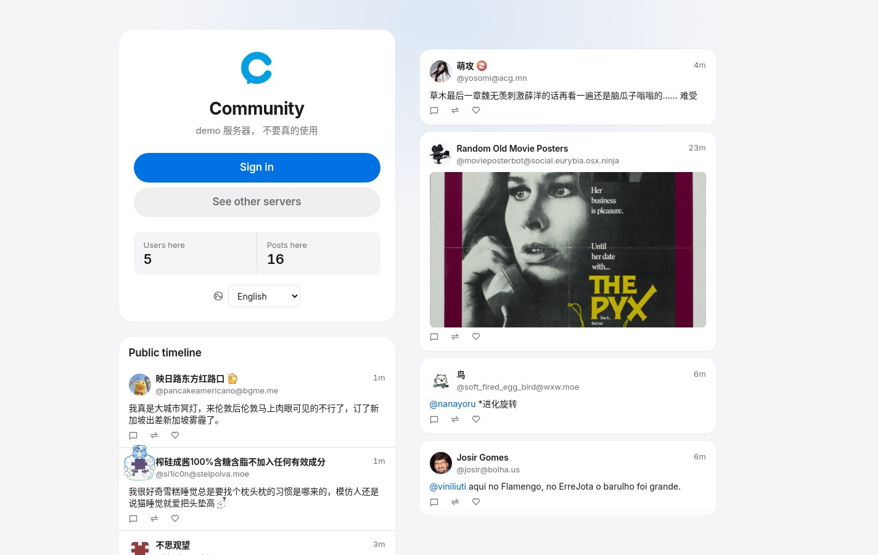
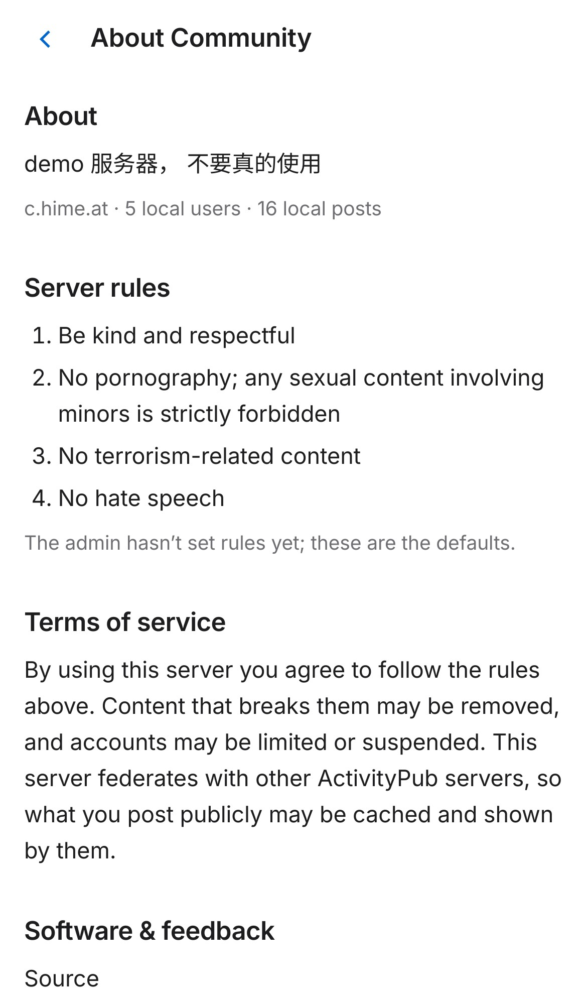

<p align="center">
  
</p>

<h1 align="center">Community</h1>

<p align="center"><b>Un petit serveur pour votre coin du fédivers : applis Mastodon, réactions façon Misskey et chat Matrix, tout est intégré.</b></p>

<p align="center">
  <a href="README.md">English</a> · <a href="README.zh-CN.md">简体中文</a> · <a href="README.zh-TW.md">繁體中文</a> · <a href="README.ja.md">日本語</a> · <a href="README.ru.md">Русский</a> · <b>Français</b> · <a href="README.de.md">Deutsch</a>
</p>

<p align="center">
  
  
  
  <a href="https://c.hime.at"></a>
</p>

<p align="center">
  
  
</p>

Community est un serveur social auto-hébergé, écrit en Go et Vue. Fils d'actualité, abonnements, réponses, sondages, médias et messages privés : tout y est, et vous pouvez échanger avec les gens sur Mastodon, Misskey et le reste du fédivers. Les salons de discussion viennent d'un serveur Matrix intégré au même programme : rien de plus à faire tourner.

Démo en ligne : **https://c.hime.at** (serveur de test, merci de ne pas l'utiliser pour de vrai).

## Pourquoi Community ?

Il existe déjà d'excellents serveurs dans le fédivers. Voici ce que Community fait autrement :

- **Gardez vos applis Mastodon.** Community implémente l'API client de Mastodon : vous pouvez vous connecter avec des applis Mastodon (vérifié avec Toot! sur iOS). En plus, vous avez des fonctions façon Misskey : réactions emoji (Unicode et personnalisées), décorations d'avatar et une interface web complète. Les réactions fédèrent dans les deux sens avec Misskey.
- **Le chat est inclus.** Un serveur Matrix est intégré au même serveur. Vos utilisateurs peuvent rejoindre des discussions de groupe depuis l'interface web, ou utiliser Element et d'autres clients Matrix (y compris les salons chiffrés de bout en bout), et parler à des gens sur d'autres serveurs Matrix. Pas besoin de faire tourner Synapse à côté.
- **Léger et simple à gérer.** Un seul binaire Go fait tourner l'API, l'appli web, la fédération et Matrix. Compatible PostgreSQL, MySQL ou SQLite. Redis est requis ; Meilisearch pour la recherche plein texte est optionnel. Sur notre démo, le processus principal utilise environ 82 Mio de mémoire.
- **Déménagez tout le serveur, gardez vos abonnés.** Vous venez de Misskey ou Mastodon ? Community importe tout le site et conserve les clés et les adresses, donc les abonnements tiennent. Voir [Changer sans repartir de zéro](#changer-sans-repartir-de-zéro).
- **Installation dans le navigateur.** Au premier démarrage, un assistant d'installation (7 langues) s'ouvre : nouvelle installation ou migration, domaine, base de données. Une fois terminé, l'assistant se verrouille.
- **Parle votre langue.** L'interface web et les messages d'erreur existent en English, 简体中文, 繁體中文, 日本語, Русский, Français et Deutsch.
- **La boîte à outils d'admin habituelle.** Relais, gestion des emoji personnalisés, blocage de domaines, filtres de contenu, stockage S3 / Cloudflare R2 / MinIO, proxy média pour les images distantes et une CLI `tootctl` façon Mastodon.

## Changer sans repartir de zéro

Voici pourquoi on quitte rarement son logiciel de fédivers : chaque compte a une paire de clés cryptographiques et une adresse fixe (l'URL de son « acteur »), et chaque publication a aussi une URL fixe. Les serveurs distants vérifient les signatures avec ces clés. Installez un autre logiciel : clés et URL changent, les signatures échouent et tous les abonnements cassent. Alors les admins abandonnent et demandent à tout le monde de repartir de zéro, ou de migrer les comptes un par un.

Community règle ce problème. Il importe **tout votre site Misskey ou Mastodon sur le même domaine** et conserve :

- **l'URL d'acteur d'origine et la paire de clés RSA** de chaque compte (ainsi que l'acteur de l'instance/système et sa clé),
- **les URL d'origine des publications** (Misskey `/notes/<id>`, Mastodon `/users/<nom>/statuses/<id>`) et les anciens liens vers les médias,

donc les serveurs distants continuent de vous faire confiance et **vos abonnés restent abonnés**. Personne n'a besoin de faire de « Move ».

**Ce qui est transféré**

- Comptes, profils, champs de profil, avatars et bannières, réglages de confidentialité
- Mots de passe (hachages bcrypt compatibles : chacun se connecte avec son ancien mot de passe)
- Publications, réponses, partages, avertissements de contenu, publications locales uniquement, pièces jointes (vrais fichiers, avec somme de contrôle) et sondages pris en charge
- Messages privés et leurs conversations, destinataires gardés privés
- Abonnements et demandes en attente, blocages, masquages (avec durée), blocages de domaine, listes, signets, favoris
- Emoji personnalisés et réactions
- Tout le reste est gardé dans une archive privée, et le rapport de pré-vérification indique précisément ce qui a été archivé

**Ce qui n'est pas transféré**

- Sessions de connexion et jetons d'applis (OAuth) : il faut se reconnecter
- Double authentification et clés de sécurité : si un compte a la 2FA activée, la pré-vérification s'arrête et vous prévient au lieu de la désactiver en douce
- Les anciennes notifications ; l'historique n'est pas renvoyé aux autres serveurs
- Certaines fonctions propres à Misskey (certaines fonctions de canaux, citations et chat) peuvent n'être qu'archivées
- Votre DNS : c'est vous qui basculez le domaine quand vous êtes prêt

**Sans risque à essayer.** Les outils d'export se contentent de lire votre ancienne base (transactions courtes en lecture seule, reprise possible après une interruption) et ne la modifient jamais : vous pouvez faire une répétition sur une base Community séparée et revenir à l'ancien serveur à tout moment. Relancer le même import ne crée pas de doublons.

**Comment :** choisissez « Migrer depuis Misskey » ou « Migrer depuis Mastodon » dans l'assistant d'installation, qui enchaîne l'export et l'import. En ligne de commande, cela se fait en deux étapes : exporter avec `scripts/migration/export_misskey.py` (ou `export_mastodon_db.py`), puis importer le paquet avec `community-transfer --scope site --input <paquet> --report …` (pré-vérification d'abord, puis `--apply`). Par défaut, seules les données de votre instance sont exportées (utilisateurs locaux, leurs publications, fichiers et abonnements, ainsi que les comptes et publications distants qu'ils référencent), pas tout le cache de contenu distant ; ajoutez `--include-remote-cache` pour tout exporter. Les utilisateurs peuvent aussi importer leurs sauvegardes personnelles Misskey/Mastodon dans leur propre compte. Testé avec Misskey 2026.10.0 et Mastodon 4.7.3. Détails, liste de contrôle et limites : [docs/data-migration.md](docs/data-migration.md).

**Grandes instances : utilisez le mode direct.** `community-transfer --source misskey --source-dsn 'host=… dbname=… user=…' --source-base-url https://votre.domaine --work-dir /private/migration` lit la base source et la diffuse directement dans l'import (environ 110 Mio de RSS maximal pour 250 Mo, contre environ 1,3 Gio), avec `--fetch-only` puis un court `--final-sync`. Pour Mastodon, utilisez `--source mastodon`. Mettez le mot de passe dans `PGPASSFILE`, pas dans le DSN. Procédure : [docs/migration.md](docs/migration.md).

## Comparaison

Un aperçu rapide et honnête. Chaque projet a ses points forts ; choisissez celui qui vous convient.

| | Community | Mastodon | Misskey | GoToSocial | Akkoma |
| --- | --- | --- | --- | --- | --- |
| Langage | Go | Ruby + Node.js | TypeScript (Node.js) | Go | Elixir |
| Processus à faire tourner | 1 appli + Redis | web, streaming, Sidekiq + Redis | appli + Redis | 1 appli | 1 appli |
| Bases de données | PostgreSQL, MySQL, SQLite | PostgreSQL | PostgreSQL | PostgreSQL, SQLite | PostgreSQL |
| Applis Mastodon | ✅ (voir remarques) | ✅ natif | ❌ | ✅ | ✅ |
| Réactions emoji | ✅ | ❌ | ✅ | ❌ | ✅ |
| Appli web intégrée | ✅ | ✅ | ✅ | Minimale (utiliser des applis) | ✅ |
| Chat Matrix intégré | ✅ | ❌ | ❌ | ❌ | ❌ |
| Assistant d'installation web | ✅ | ❌ (CLI) | ❌ | ❌ | ❌ (CLI) |
| Import d'un site Misskey/Mastodon entier sur le même domaine | ✅ | ❌ | ❌ | ❌ | ❌ |

**Si vous aimez GoToSocial pour sa légèreté :** Community joue dans la même catégorie, avec en plus une appli web complète, des réactions façon Misskey, le chat Matrix et la migration de site. GoToSocial n'a pas besoin de Redis ; Community, si.

**Bon à savoir avant de changer :**

- Modifier une publication revient à « supprimer et republier » : vous obtenez une nouvelle publication, les favoris et réponses ne suivent pas. L'endpoint d'édition de Mastodon renvoie `405`, donc les applis qui s'appuient dessus doivent s'adapter.
- Les réactions passent par une extension d'API propre à Community ; les applis Mastodon classiques les affichent comme des favoris, ou pas du tout.
- C'est un projet jeune. Voir [docs/federation.md](docs/federation.md) pour savoir exactement ce qui a été testé avec quel logiciel.

## Démarrage rapide

Il vous faut Docker avec Compose v2.24 ou plus récent.

```bash
git clone https://github.com/kasuganosora/community.git
cd community
cp .env.setup.example .env
# Réglez COMPOSE_PROFILES sur postgres ou mysql, et remplacez BUNDLED_DB_PASSWORD.
# N'ajoutez pas de variables DB_* : cela saute l'assistant.
docker compose up -d --build
docker compose logs community | grep -A3 "install token"
```

Ouvrez ensuite `http://<votre-serveur>:8080/setup`, collez le jeton, choisissez « Base de données intégrée » et suivez l'assistant. Pour un serveur public, placez un proxy inverse HTTPS devant et utilisez votre domaine définitif : il fait partie de l'identité de chaque compte et ne devrait plus changer.

Plus d'options (`.env` manuel, bases externes, S3) : [docs/setup.md](docs/setup.md) et [docs/configuration.md](docs/configuration.md).

## Ce qu'il vous faut

| Niveau | Matériel | Configuration | Ce que vous obtenez |
| --- | --- | --- | --- |
| **Minimum** (fonctions réduites) | 1 vCPU, 1 Go de RAM | SQLite + Redis, sans Meilisearch, quelques utilisateurs | Tout fonctionne, mais sans recherche plein texte (repli sur la base), traitement des médias et rattrapage de la fédération plus lents |
| **Recommandé** | 2 vCPU, 2–4 Go de RAM | PostgreSQL + Redis, Meilisearch optionnel | Toutes les fonctions |
| **Instances moyennes et plus** | Selon le nombre d'utilisateurs et le trafic fédéré | | Voir [docs/tuning.md](docs/tuning.md) |

Nos mesures (dans Docker avec limites strictes CPU/mémoire et swap désactivé, le 17 octobre 2026 ; 10 utilisateurs et 8 clients simultanés pendant 10 minutes : fils, publications, sondages, envoi de médias et favoris) :

- **Niveau minimum** (toute la pile limitée à 1 CPU / 1 Go) : Community utilisait 78 Mio au repos et 196 Mio au pic, Redis moins de 10 Mio. Aucun arrêt pour manque de mémoire. Environ 97 requêtes/s, médiane 71 ms, 95e centile 198 ms.
- **Niveau recommandé** (PostgreSQL + Redis + Meilisearch, 2 CPU) : Community a culminé à 215–250 Mio, PostgreSQL ~300 Mio, Redis ~30 Mio. Avec 2 Go au total, Meilisearch (limité à 704 Mio) a été arrêté faute de mémoire, Community a continué de tourner et la recherche s'est repliée sur la base ; avec 4 Go, tout est resté debout et Meilisearch a culminé à 733 Mio. **Si vous voulez Meilisearch, prévoyez 4 Go** (ou au moins 1 Go rien que pour lui).

Sur le serveur de démo (octobre 2026), Community utilise environ 82 Mio, Redis 141 Mio et Meilisearch 932 Mio : Meilisearch est de loin le plus gourmand, c'est pourquoi il est optionnel. Chiffres bruts et comment les reproduire : [docs/benchmarks.md](docs/benchmarks.md). Les miniatures vidéo nécessitent FFmpeg (inclus dans l'image Docker).

## Compatibilité

- **Fédivers :** testé avec Misskey et Mastodon (abonnements, réponses, messages privés, suppressions, emoji personnalisés, réactions, médias). Les relais ActivityPub sont aussi pris en charge.
- **Matrix :** testé avec Synapse et Element Web, y compris les salons chiffrés et les pièces jointes.
- **Applis Mastodon :** vérifié avec **Toot! (iOS)** sur la démo (connexion et fils, octobre 2026). Community implémente l'API client de Mastodon, donc la plupart des applis Mastodon devraient fonctionner aussi (en gardant en tête la remarque sur l'édition).
- **Applis Matrix :** vérifié avec Element Web.

Versions testées et limites connues : [docs/federation.md](docs/federation.md).

## Mise à jour

`git pull && docker compose up -d --build`. Les migrations de base de données s'exécutent au démarrage. **Sauvegardez d'abord votre base et `uploads/`.** Voir [docs/setup.md](docs/setup.md#upgrading-an-existing-deployment-ops).

## Documentation

- [Assistant d'installation et fichier de configuration](docs/setup.md)
- [Installation et configuration](docs/configuration.md)
- [Migration des données](docs/data-migration.md)
- [Fonctions en détail](docs/features.md)
- [Fédération et compatibilité](docs/federation.md)
- [Console d'administration](docs/admin-console.md) · [tootctl](docs/tootctl.md)
- [Optimisation](docs/tuning.md) · [Mesures de performance](docs/benchmarks.md)
- [Architecture et plan du code](docs/architecture.md) · [Développement et tests](docs/development.md)
- Pour aller plus loin : [Feed](docs/feed-runtime.md), [Recommandations](docs/recommendations.md), [Aperçus de liens](docs/link-previews.md), [Groupes web Matrix](docs/matrix-web-groups.md), [Messages privés Matrix ↔ ActivityPub](docs/matrix-activitypub-direct.md)

## Contribuer

Les tickets et pull requests sont les bienvenus sur [GitHub Issues](https://github.com/kasuganosora/community/issues). Pour un problème de compatibilité, indiquez la version du client ou du serveur, les étapes pour reproduire et des journaux anonymisés. Pour compiler et lancer les tests en local : [docs/development.md](docs/development.md).

## Licence

Community est distribué sous [licence MIT](LICENSE). La copie intégrée de gomatrixserverlib dans `third_party/gomatrixserverlib` reste sous licence Apache 2.0 (voir son [LICENSE](third_party/gomatrixserverlib/LICENSE) et [NOTICE](NOTICE)).

## Remerciements

Community s'appuie sur [Mastodon](https://github.com/mastodon/mastodon), [Misskey](https://github.com/misskey-dev/misskey), [GoToSocial](https://github.com/superseriousbusiness/gotosocial), [Akkoma](https://akkoma.dev/AkkomaGang/akkoma), la spécification [Matrix](https://matrix.org), [Synapse](https://github.com/element-hq/synapse) / [Element](https://element.io) et toute la communauté ActivityPub. Merci !
