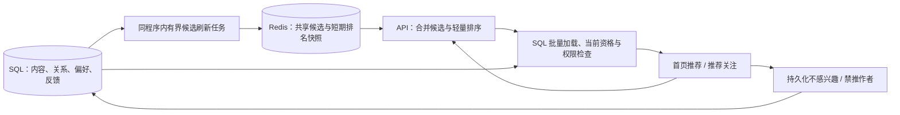

# Community 推荐功能预研

日期：2026-10-14（Asia/Shanghai）。代码基线：`379b973`。状态：**仅完成代码盘点与方案研究，尚未实施推荐功能、埋点或推荐压测**。文中的数量、权重、容量与延迟均为待验证的初始预算，不是实测结果。

## 1. 建议做什么

首版将**首页现有「推荐」标签接入真正的推荐时间线**，同时完善「推荐关注」：用关注话题、已接受的关注关系、对公开帖的明确互动，发现尚未关注的作者和公开内容。首页「关注」继续按时间排序；探索的「本站」「跨站」保留。推荐是可关闭、可解释的独立入口，不另在探索页重复增加相同时间线。

2026-10-14 补充核实：首页目前虽然写着「推荐」，实际选择 `publicTimeline`，调用 `/api/v1/timelines/public`；它只是公开时间线，没有推荐排序。此项是现有界面文案与实现不符，不代表已完成推荐功能。下一次实施必须替换这条数据链路，不能仅改名称或把公开流随机打乱。

适合本项目的起点是 **共享候选池 + 阅读时轻量排序 + 当前数据库权限检查**。沿用 Go、关系数据库、Redis，无需先增加向量数据库、模型服务、Kafka 或独立推荐微服务。首版不把推荐帖子逐个投递到所有用户的主页，避免重新制造粉丝扇出成本。

优先级建议：

| 顺序 | 用户得到什么 | 边界 |
| --- | --- | --- |
| P0 | 推荐关注不会反复出现已移除的人，过滤规则可靠 | 修复已有实现；先建立统一推荐资格 |
| P1 | 可解释的公开帖子推荐、推荐关注 | 规则排序，初始依据明确选择；不分析私密内容 |
| P2 | 更好的兴趣匹配、曝光去重和质量评估 | 有真实使用量后才增加行为汇总和实验 |
| P3 | 公开群发现建议 | 独立群卡片，只用公开目录元数据；不分析群消息 |
| 后续可选 | 语义匹配或学习排序 | 先证明规则方案的瓶颈和新方案的收益 |

## 2. 当前代码能提供什么

以下路径相对于仓库根目录，行号对应上述基线。

| 能力 | 代码依据 | 结论 |
| --- | --- | --- |
| 首页「推荐」 | `frontend/src/domains/timeline/presentation/pages/HomePage.vue:18`、`:26`、`:69`；`frontend/src/domains/timeline/infrastructure/timelineApi.ts:12` | 标签为推荐，实际读取 public 时间线；尚无真正推荐接口或排名状态 |
| 探索时间线 | `frontend/src/domains/timeline/presentation/pages/ExplorePage.vue:20` | 当前仅有本站/跨站，调用公开时间线；并非个性化推荐 |
| 推荐关注 | `controllers/api/account/suggestions.go:13` | 二跳关注图，按粉丝数排序；没有候选时退到热门账号 |
| 移除推荐 | 同文件 `:97` | 当前只返回成功，没有保存移除状态 |
| 热门帖子 | `controllers/api/trends/trends.go:93` | 最近 7 天，转发数 + 点赞数排序；不包括自定义表情回应，使用 offset 分页 |
| 热门话题 | 同文件 `:18` | 近 7 天用过的话题按累计计数排序；不是严格的 7 天窗口增量统计 |
| 热门链接 | 同文件 `:138` | 聚合 `status_cards`，没有联表重新检查帖子的当前公开资格 |
| 公开账号目录 | `controllers/api/account/directory.go:44`、`:115` | 有 discoverable、账号状态、域限制、屏蔽/静音过滤，可提炼；不能直接认为已覆盖全部推荐规则 |
| 帖子和行为 | `models/status.go:38`、`:1473`、`:1518`；`models/status_reaction.go:27`；`models/follow.go:17`；`controllers/api/account/followed_tags.go` | 有语言、标签、发帖时间、可见性、点赞、收藏、转发、回应、关注和关注话题 |
| 阅读活跃 | `feed/activity.go:23` | 记录账号最近使用 Feed 的时间，没有逐帖曝光/阅读时长；不能当成阅读历史 |
| 当前权限检查 | `models/status_access_batch.go:12`、`serializer/status.go:241` | 可以批量复用；静音、推荐资格与内容过滤还需单独组合 |
| Feed 基础设施 | `feed/README.md`、`docs/feed-runtime.md` | 已有批量加载、有界缓存、租约、取消/超时、横向部署模式；推荐可复用这些设计和底层工具 |
| 群目录 | `matrix/homeserver/public_directory.go:121`、`web_groups_directory.go` | 公开列出是明确选择，和允许公开入群不同；已有指定服务器目录查询，不是全网搜索 |

项目已有可选 Meilisearch。它可以在后续改善关键词召回，但推荐首版不要求安装，也不能把搜索结果直接当成已授权的内容。

### 必须先补的缺口

1. **推荐关注过滤不完整。** 两跳查询未限定 `FollowStatusFollowed`，也未统一检查 discoverable、封禁、屏蔽、静音；热门回退还会返回已关注账号。两跳关系两端都应是已接受关注，已发送申请也应从新推荐中排除。移除推荐必须持久化并允许撤销。
2. **热门链接不适合直接作为公共推荐池。** `linkcard/service.go:123` 排除已删除、定时、转发和 direct，但 private / unlisted 帖子可以生成预览。热门链接聚合没有重新检查 public 资格，存在把这些预览链接带入热门响应的代码路径。这里是源码审查发现，未声称已复现线上泄漏。实施 P0 时应修复读时资格，并覆盖帖子变更、删除及封禁；不能只修未来预览写入。
3. **远端发现偏好尚未完整入库。** `activitypub/models.go:6` 的 Actor 未声明 discoverable / indexable / hideCollections；`resolver.go:380` 的创建和 `account_refresh.go`、`inbox.go` 的更新路径没有完整写入。现有远端 `discoverable=false` 可能只是默认值。需区分未知/明确允许/明确拒绝，覆盖解析、刷新、Update、本地 Actor 导出和导入数据；测试缺失、false、true、null/非法值及允许→拒绝，缺字段不能误当允许。历史 unknown 仅按候选需求有界刷新。不得把旧记录批量改成允许，也不能因此隐藏原有公开时间线或精确搜索结果。
4. **排序分页不能直接套 Feed 的 ID 游标。** `feed/get_timeline_content.go:325` 的加载按 ID 倒序，现有前端分页也面向时间线。推荐需要保留排名顺序和自己的游标协议。

## 3. 推荐资格和数据边界

建议把三件事分开：对象能否读取、对象是否允许主动推荐、这个用户是否希望看到。

- 帖子候选只包含已发布、未删除的 **public 原帖**。首版不主动推荐回复和转发壳；转发是互动信号，最终推荐原帖。排除 unlisted、仅关注者可见、私信、历史回填帖子和明显过期内容。
- 首版主动推荐的作者要求明确允许被发现，并尊重明确的禁止索引/推荐偏好；未知先不主动推荐。`discoverable` 与 `indexable/noindex` 含义不同，应分别保存，禁止索引不能被解释成允许发现。锁定账号只表示关注需审批，不能替代发现偏好或帖子权限。
- 重新检查账号/用户有效状态、本站和个人域限制、双向屏蔽、限时静音、对帖静音、隐藏关键词、禁推反馈。公开发现应排除被限流域；不要沿用「关注者仍可读」来允许主动推广。
- 引用、转发原帖、图片、投票、链接预览也必须走已有序列化和权限检查。`FilterVisibleStatuses` 本身不等于完整推荐过滤，`Filtered` 标记也不能代替服务端剔除 hide 内容。保留 warn/CW 与敏感媒体的用户设置。
- 公开互动仅表示本站观察到的一部分联邦行为。不得宣称全网热度，不抓取全网粉丝图或远端收藏。远端粉丝数等自报总量不能成为主要排名依据；两跳召回只使用允许公开的中间关注关系，不把 `HideCollections` 隐藏的关系变成推荐证据。
- 私信、私有帖、Matrix 房间消息/成员关系/已读回执、私有群名，以及跨协议私信桥接内容，均不用于推荐或画像。首版也不使用收藏作为公共热度；若以后将用户自己的收藏用于个人偏好，需独立说明和开关。
- 群推荐只读取明确公开列出的目录元数据。自己加入了某群不等于允许把它推荐给别人；不分析外部桥接成员属于什么系统。加密群标注使用客户端，不显示「网页直接聊天」。

过滤以请求开始后取得的当前数据库状态为依据，不能信任缓存里的可见性或账号标记；已发送到客户端的内容无法远程抹除。相关设置、删除和封禁改变后，新请求立即执行新规则；页面恢复和换账号要重新校验/清空旧窗口。

## 4. 首版架构：先保持小



### 4.1 候选来源

每次最多合并约 400 个 ID，首版以最近 7 天为候选窗口：

| 来源 | 初始预算 | 目的 |
| --- | ---: | --- |
| 已关注话题、用户明确选择的语言 | 150 | 先满足用户明确兴趣；空语言作为未知，不自动判断不匹配 |
| 已接受关注关系带来的公开互动 | 100 | 发现社交图附近的新内容；仅使用可公开表达的证据 |
| 本站已观察到的近期有效热度 | 100 | 冷启动与补足；以不同有效互动账号计数 |
| 新作者/近期低互动内容探索 | 50 | 防止大账号永久占满；使用稳定种子做有限探索。没有曝光数据时不声称识别了低曝光内容 |

数量是上限，不要求凑满。原帖去重后，先批量检查账号/可见性资格并排序；按排名分批加载正文、CW 和原文关联，执行关键词 hide/warn 和最终序列化，再对实际返回条目应用作者/来源多样性限制。关键词判断需要正文，不能只靠 ID 或元数据完成；也不为此一次加载全部 400 条的附件/投票。被过滤的条目在请求预算内补足，候选不足时允许短页，不为填满而放宽资格。

共享池按本站/已知跨站、少量活跃语言/话题分桶，首版最多 128 个活跃桶、每桶最多 2,000 个轻量条目；不允许请求中的任意字符串无限创建桶。个性化关系查询限制边数和时限，热门大账号的二跳关系不能在 HTTP 请求里无界展开；超预算就降低此路权重。

后台按索引对近期 SQL 记录有界扫描并周期重建，初始每 2 分钟更新热点池。设置每轮扫描/时间上限并记录截断率；达到上限不宣称全量热榜。时间窗口按帖子实际发布时间处理，远端导入/回填不得靠本地新 ID 获得「新帖」加成。初期关系与个人兴趣直接从有限的当前行为记录计算，避免新增用户全量画像任务。

### 4.2 初始排序

第一版用可解释规则，所有特征缩放到 0–1，再进行排序。可以从以下试验配置开始：

```text
score = 0.35 × 话题匹配
      + 0.25 × 社交相关
      + 0.20 × 时间衰减
      + 0.15 × 有上限的有效互动热度
      + 0.05 × 探索项
```

这不是已经验证的最佳权重。语言优先是用户选择；不猜测敏感个人属性。热度按不同账号归一：同一账号对同一帖的点赞/表情回应/转发不能无限叠加，取消互动应回退；表情回应表达参与，不自动等同于赞同。新注册、明显机器人和单域集中互动的贡献设上限，但不能将所有新用户永久排除。

每 20 条初始最多同作者 2 条、同远端实例 8 条，预留约 20% 给新内容/新作者；本站内容池和语言较小时可减少返回数量。限制和放宽策略都要有指标，不能为了达标掺入不合格帖子。推荐关注使用相同资格层、持久移除和多样性规则，不再单纯按全网粉丝数排榜。

理由只显示可证明且不暴露关系隐私的说明，例如「你关注的话题」「近期活跃的作者」。默认不点名「某某收藏/点赞过」，尤其不从隐藏关系或私密互动生成理由。

### 4.3 持久数据和缓存

推荐首版新增一个 `recommendation_feedback` 表，保存用户明确的不感兴趣/禁推目标；P0 另需为已有账号模型补齐远端发现偏好的未知状态、来源和刷新时间。反馈唯一键建议为 `(account_id, target_kind, target_key)`，含固定 action、创建/更新时间和可选到期时间。ID/目标类型校验、授权、幂等写入、撤销、账号删除/导出都必须覆盖。禁推默认保持到用户撤销，不用 Redis TTL 使它悄悄失效。

阅读推荐开关、语言和兴趣偏好可以扩展现有 `UserSetting.Data`，但要补并发安全的局部更新或行锁合并，不能照搬整个 JSON 读改写覆盖其他设置。是否允许自己被推荐属于账号发现偏好，与是否阅读个性化推荐分开。读取反馈失败应返回错误，不能忽略用户的明确拒绝继续展示。

候选池与短期排名快照只保存 ID、少量特征、版本和生成时间，可由当前 SQL 重建。不复制正文，不新增「每个用户 × 每条候选」的持久投递表。首版不需要新的推荐 outbox 或永久行为流水。

缓存任务不是可靠消息投递：一个桶用带 token/generation 的租约协调，旧任务只能在租约仍有效时 CAS 发布；丢失租约或 Redis 重启就丢弃该次生成，下一轮重建。所有 Lua 键按桶使用同一 Cluster hash tag；新代缓存完整发布后再切换，不让读者看到半张榜单。无需借用 `feed_events/feed_batches` 的消费、ACK 或重试记录。

每用户最多 2 个短期快照，每快照最多 200 个排名 ID，初始 TTL 10 分钟；设置全局内存预算、活跃用户预算和清理指标。Redis 当前使用 `noeviction`，新增缓存必须预留容量；申请失败就降级，不能挤占 Feed 的正确性元数据。预算含新旧 generation 并存和 Redis 对象开销；新池发布失败不能先删除仍有效的旧池。扩容前报告实际每池/每快照内存，不能只用 ID 的字节数估算 Redis 总占用。

### 4.4 分页与前端

新增 Community 专用接口，例如 `GET /api/v1/discovery/statuses?cursor=...&limit=20`；现有 Mastodon 时间线 API 保持原契约。响应携带 `items`、`next_cursor`、`generation`、`mode`，卡片理由采用固定 reason code；推荐关注 v1/v2 可复用内部服务，但保留客户端兼容字段。

游标绑定登录账号、查询偏好、算法版本、快照 generation、扫描位置和过期时间，并签名。后续页读取固定快照，不能使用热门榜的 offset 或 `max_id` 假装稳定排序；加载正文后恢复原排名。过滤后推进到最后扫描位置，允许在有限预算内补足，避免重复/死循环。

快照失效、Redis 丢失、设置切换需明确 `reset_required`，前端提示刷新，不偷偷新建一张榜继续旧游标。新帖提示由用户点击后生成新一轮结果，不边阅读边跳位。另需为页面恢复提供「重新校验已有窗口 ID」路径，仍要检查快照归属和当前资格；不能只按旧排序缓存直接恢复卡片。

复用现有 `TimelineFeed` 卡片、虚拟列表和媒体交互，给推荐新增适合上述游标的加载器；不能直接套目前按时间 ID 的 `usePaginatedList` 请求约定。会话切换、迟到响应和导航快照要绑定 `sessionEpoch`。每条有「为什么推荐」「不感兴趣」「不再推荐这个作者」，失败要恢复按钮状态并保留重试；明确区分禁推和全站屏蔽。

首页 `for-you` 改为独立推荐 API、排名快照和加载状态，不再映射到 `publicTimeline/publicStatuses`；`following` 仍调用 `/api/v1/timelines/home`。推荐不能与公共时间线共用缓存、游标或新帖处理逻辑，也不能将一次 public SSE 提示直接当作需要重排推荐的命令。公开流留在探索页；推荐未开启或关闭时清楚展示相应模式/入口，不能继续将未排序的公开流标为个性化推荐。

### 4.5 故障与扩容

- 首版刷新任务在同一 Community 二进制中运行，用独立开关、并发预算、数据库连接预算和指标。当前 `COMMUNITY_ROLE` 只认 all/api/feed-worker；不能宣称已经存在 recommendation-worker。以后需要独立扩容时再增加该角色，与 Feed worker 互不占领取槽。
- Redis 故障时首屏可退回经过同等推荐资格检查的 SQL 公开时间序结果，并用 `mode=chronological_fallback` 明确告知。首版该模式仅提供最多 20 条首屏，`next_cursor=null`，不显示继续加载，提供刷新或进入原有本站/跨站时间线的入口；它不是「内容已经全部读完」。旧推荐游标返回 `reset_required`，不能换成时间游标或返回依赖故障 Redis 的下一页。SQL 回源有并发和时间上限，超限返回 503/Retry-After，不返回假空页。
- SQL/授权或持久反馈读取失败时不得返回未经检查的缓存正文。推荐故障应只影响推荐标签，不能阻塞发帖、首页关注时间线、ActivityPub 投递或 Matrix 同步。
- 读 API 无进程本地必需状态，可增加副本；候选任务按桶分工。先增加实际 CPU/数据库资源和观察瓶颈，再决定 Redis Cluster；不在同一固定 CPU 配额里增加进程就宣称线性扩展。
- 不从 `feed_events` 用全局递增 ID 游标旁路消费。现有任务有自己的完成/清理协议，ID 分配顺序不等于提交顺序。P2 若确实需要增量汇总，再设计独立可靠投影协议及周期对账。

## 5. 何时需要更多数据

P1 可以用已有关系与公开互动取得基本效果，不收集逐帖阅读时长。新用户没有足够关系时，用明确选择的话题/语言、合格的新内容和人工挑选的公开账号补足；人工挑选也必须经过相同资格检查。合格候选为空时提示选择话题或浏览本站/跨站，不自动替用户关注，不让粉丝数决定全部展示。

P2 先补真实曝光口径，再评估点击/互动效果：前台标签页中卡片可见面积至少 50%、连续 1 秒才计曝光；预取、后台页、瞬间滚过不算。同用户/对象/实验窗口去重，曝光必须对应服务端确实发出的候选；不要把返回了 20 条当成读了 20 条。事件接收限流、批量、校验和容量上限独立，不影响浏览。

这时才考虑短保留事件表和按日汇总：原始曝光可初设 7 天，聚合 30 天，后台分批过期；不存正文、私信、搜索词或私人群关系。偏好重置/关闭个性化后清除画像与缓存，停止画像采集，同时保留用户主动设置的禁推规则，除非用户明确清除它们。分析展示的数据也要说明是本站已观察数据。

模型引入门槛：规则方案已有稳定曝光基线、足够反馈和人工相关性样本；明确证明某类内容召回不足。可先评估已有搜索关键词，再对用户允许索引的公开文本试验向量召回。任何模型只提供候选/分数，不承担授权判定。

## 6. 群推荐放在后续独立实现

群组适合先做「公开群发现」而非信息流混排。初版选本站公开目录和管理员明确配置的少量远端目录，使用名称、主题、语言、目录人数等公开元数据；人数仅作弱信号，不能用它断言消息活跃。远端目录服务不在线时使用有有效期的快照或说明暂不可用，不在每次推荐请求里同步扫联邦。

推荐卡片区分可加入/需申请/需客户端，点击预览不自动加入。私有目录条目、已退群列表和仅本人可见的群搜索结果不得进入公共候选。目录由公开变为私有应失效；无法确认远端旧缓存是否仍公开时过期停推。为用户明确选择的外部目录保留查询来源提示，不能为推荐自动发送私人兴趣词。

这与现有群边界一致：网页原生只面向 Community/Matrix，不增加 ActivityPub 群语义，也不尝试识别外部系统桥接成员。

## 7. 实施拆分与验收

| 阶段 | 主要改动位置 | 完成标准 |
| --- | --- | --- |
| P0：资格与反馈 | suggestions、trends、AP Actor 解析/更新/导出、models 资格服务/反馈、偏好 API | 当前缺口定向复现并修复；已移除、已关注/申请、双向屏蔽/静音/封禁账号均不再推荐；未知远端偏好不被误当允许 |
| P1：可用推荐 | 新 `discovery/` 服务、候选任务/缓存、专用 API、HomePage 推荐加载器与推荐关注 | 首页推荐真正使用独立排名接口；稳定分页、解释/反馈/关闭入口、冷启动、故障回退、已有时间线/客户端兼容回归 |
| P2：质量和扩展 | 可选曝光、汇总、实验、独立运行角色 | 有效曝光可审计；相关性或发现新作者有证据改善，负反馈与性能没有恶化 |
| P3：公开群发现 | 包装后的群目录服务与发现卡片 | 无私有群泄漏，不自动入群，不影响聊天，不依赖全网扫描 |

建议自动化验收至少包括：

1. **正确性**：public/unlisted/private/direct、定时/删除/回填、原帖/引用、域限制/子域策略、封禁/删除账号、已申请/已关注、静音到期、关键词 hide/warn、敏感媒体和发现偏好矩阵。候选缓存故意放入不合格 ID，响应仍应完全排除；反馈成功后下一次请求生效。
2. **排名与分页**：固定快照跨 2 个 API 副本重复请求得到一致次序；同时发帖、删除、取关、封禁和新增反馈后仍无重复/泄漏；快照到期、错账号、被篡改游标明确失败/重置。只承诺固定快照内的合格候选遍历，不承诺覆盖全网内容。
3. **交互和真实接入**：验证首页推荐实际请求新接口，关注仍请求 home，探索仍请求 public；两名明确选择不同话题的测试用户在相同候选池得到符合其偏好的排名，理由与实际特征一致，不能用随机差异冒充个性化。覆盖手机/桌面、深浅色、键盘、解释弹层、反馈撤销、断线、换账号、返回恢复；复用已有虚拟列表有界约束，不自动改变阅读位置。
4. **缓存任务**：租约过期的旧任务不能覆盖新 generation；SQL/Redis 故障、缓存清空、任务终止可自然重建；推荐暂停不拖慢 Feed/Matrix 队列，错误和降级均可观察。
5. **数据库兼容**：SQL 和 JSON 操作在 MySQL、PostgreSQL、SQLite 分别回归，真实两种生产数据库检查执行计划、唯一约束和并发偏好更新。新增索引以实测查询为准，不能只依赖 SQLite。

建议初始性能门槛：每页 20 条，热请求 p95 ≤ 150ms、p99 ≤ 300ms；冷构建/降级有界在 1s 内成功或明确拒绝；候选刷新正常滞后 ≤ 5 分钟。都是待验证目标。使用固定开放到达率、至少 10 分钟 × 3 轮、独立 1 万账号/100 万帖子档，记录请求丢弃、错误、SQL 扫描行数、连接等待、CPU 和 Redis 内存。读时不做外部网络请求，不出现随候选条数增长的逐帖 SQL。

在相同输入和资源预算下，建议原主页 p95 退化不超过 10%，Matrix/联邦投递队列年龄不出现持续增长；超限先降推荐并发。现有 [Feed 性能记录](feed-validation-20261011.md) 的短测不能代替这些验收，既有 Worker 横向扩展目标也尚未完全达到，不能据此预报推荐吞吐。

质量评估先与「最新公开帖」及「当前热度排序」两个基线比较。用自愿标注的相关性样本比较 NDCG@20、作者/实例覆盖和重复率；线上再看每百次**有效曝光**带来的关注/收藏、负反馈/举报和次日回访。按新用户、只阅读用户、活跃用户及语言分组，防止平均值掩盖冷启动退化。数据不足就报告不足，不承诺固定点击率提升，也不把互动相关性当成因果收益。

## 8. 上线和回退建议

先修 P0，再做 P1 影子排序：仅记录聚合指标和版本，不改变用户结果。随后给自愿参与用户开启首页真正的推荐时间线；保留关注时间线与手动关闭。分阶段期间未接入新接口的公开流应标明为公开内容，不冒充推荐结果。算法版本、权重和候选来源有版本化配置，不支持在后台提交任意 SQL 或代码。

后台第一版只需开关、模式、候选池新鲜度、过滤/降级原因、延迟、缓存容量和任务状态；明确不展示用户私人兴趣画像。P1 不展示尚无可靠口径的曝光率/点击率，质量先用人工样本；行为指标到 P2 再开放。停用推荐任务和新入口即可回退，已有帖子/关系/群聊不受影响，用户禁推反馈保留。扩容、模型、曝光流水都以真实收益为条件后置。

本次预研未修改运行配置或业务逻辑，未新增推荐埋点，也未执行新的负载测试。建议下一次开发任务先完成 P0 和 P1，公开群推荐与模型排序独立排期。
