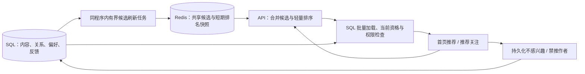

# Community 推荐功能预研

日期：2026-10-14（Asia/Shanghai）。代码基线：`379b973`。状态：**仅完成代码盘点与方案研究，尚未实施推荐功能、埋点或推荐压测**。文中的数量、权重、容量与延迟均为待验证的初始预算，不是实测结果。

本版补充论文、官方技术文档和固定版本源码研究；[资料、证据与取舍](community-recommendation-sources.md) 记录实际阅读范围与来源。主要采用 Meilisearch 多路召回、RRF 排名融合、Mastodon 的参与人数/热度治理经验和 Bluesky 的候选 ID 骨架边界；BPR 与抽样评估论文用于约束反馈和验收。没有引入模型训练服务，也没有把上游实验结果当成本项目收益。

## 1. 建议做什么

首版将**首页现有「推荐」标签接入真正的推荐时间线**，同时完善「推荐关注」：用关注话题、已接受的关注关系、对公开帖的明确互动，发现尚未关注的作者和公开内容。首页「关注」继续按时间排序；探索的「本站」「跨站」保留。推荐是可关闭、可解释的独立入口，不另在探索页重复增加相同时间线。

2026-10-14 补充核实：首页目前虽然写着「推荐」，实际选择 `publicTimeline`，调用 `/api/v1/timelines/public`；它只是公开时间线，没有推荐排序。此项是现有界面文案与实现不符，不代表已完成推荐功能。下一次实施必须替换这条数据链路，不能仅改名称或把公开流随机打乱。

适合本项目的起点是 **共享候选池 + 阅读时轻量排序 + 当前数据库权限检查**。沿用 Go、关系数据库、Redis；已有 Meilisearch 且推荐索引就绪时自动启用多路内容召回和排序融合，未启用时仍可使用规则推荐。无需先增加向量数据库、模型服务、Kafka 或独立推荐微服务。首版不把推荐帖子逐个投递到所有用户的主页，避免重新制造粉丝扇出成本。

优先级建议：

| 顺序 | 用户得到什么 | 边界 |
| --- | --- | --- |
| P0 | 推荐关注不会反复出现已移除的人，过滤规则可靠 | 修复已有实现；先建立统一推荐资格 |
| P1 | 可解释的首页推荐、推荐关注、热点 `#话题` 列表 | 基础规则 + 可自动启用的 Meilisearch 内容增强；不分析私密内容 |
| P2 | 更好的兴趣匹配、曝光去重和质量评估 | 有真实使用量后才增加行为汇总和实验 |
| P3 | 公开群发现建议 | 独立群卡片，只用公开目录元数据；不分析群消息 |
| 后续可选 | 语义匹配或学习排序 | 先证明规则方案的瓶颈和新方案的收益 |

## 2. 当前代码能提供什么

以下路径相对于仓库根目录，行号对应上述基线。

| 能力 | 代码依据 | 结论 |
| --- | --- | --- |
| 首页「推荐」 | `frontend/src/domains/timeline/presentation/pages/HomePage.vue:18`、`:26`、`:69`；`frontend/src/domains/timeline/infrastructure/timelineApi.ts:12` | 标签为推荐，实际读取 public 时间线；尚无真正推荐接口或排名状态 |
| 探索时间线 | `frontend/src/domains/timeline/presentation/pages/ExplorePage.vue:20` | 当前仅有本站/跨站，调用公开时间线；并非个性化推荐 |
| 推荐关注 | `controllers/api/account/suggestions.go:13` | 二跳关注图，按粉丝数排序；没有候选时退到热门账号 |
| 移除推荐 | 同文件 `:97` | 当前只返回成功，没有保存移除状态 |
| 热门帖子 | `controllers/api/trends/trends.go:93` | 最近 7 天，转发数 + 点赞数排序；不包括自定义表情回应，使用 offset 分页 |
| 热门话题 | 同文件 `:18` | 近 7 天用过的话题按累计计数排序；不是严格的 7 天窗口增量统计 |
| 热门链接 | 同文件 `:138` | 聚合 `status_cards`，没有联表重新检查帖子的当前公开资格 |
| 公开账号目录 | `controllers/api/account/directory.go:44`、`:115` | 有 discoverable、账号状态、域限制、屏蔽/静音过滤，可提炼；不能直接认为已覆盖全部推荐规则 |
| 帖子和行为 | `models/status.go:38`、`:1473`、`:1518`；`models/status_reaction.go:27`；`models/follow.go:17`；`controllers/api/account/followed_tags.go` | 有语言、标签、发帖时间、可见性、点赞、收藏、转发、回应、关注和关注话题 |
| 阅读活跃 | `feed/activity.go:23` | 记录账号最近使用 Feed 的时间，没有逐帖曝光/阅读时长；不能当成阅读历史 |
| 当前权限检查 | `models/status_access_batch.go:12`、`serializer/status.go:241` | 可以批量复用；静音、推荐资格与内容过滤还需单独组合 |
| Feed 基础设施 | `feed/README.md`、`docs/feed-runtime.md` | 已有批量加载、有界缓存、租约、取消/超时、横向部署模式；推荐可复用这些设计和底层工具 |
| 群目录 | `matrix/homeserver/public_directory.go:121`、`web_groups_directory.go` | 公开列出是明确选择，和允许公开入群不同；已有指定服务器目录查询，不是全网搜索 |

项目已有可选 Meilisearch，**首版就支持在其可用时自动增强推荐**。现有 `search/meilisearch.go:71` 帖子文档只有正文/CW、作者、可见性、发布时间，没有话题、语言、推荐资格和向量；`:697` 的搜索接口返回 ID，`created_at:desc` 在词法排名前级打平后参与排序，并非纯时间倒序。`search/indexsync/sync.go:24` 注册回填，`:35` 使用进程内事件异步更新；引擎 enabled 不等于推荐索引回填完成或内容新鲜。需要补足专用索引与就绪检测，不能直接把搜索结果当成已授权内容。

热门话题也不是从零开始：`frontend/src/shared/components/widgets/TrendingCard.vue:7` 已读取 `/api/v1/trends/tags`，显示 5 个话题；`:52` 的更多入口只是跳到探索页，没有完整热点列表。后端需修复统计口径，前端需补完整列表与窄屏入口。

### 必须先补的缺口

1. **推荐关注过滤与版本契约不完整。** 两跳查询未限定 `FollowStatusFollowed`，也未统一检查 discoverable、封禁、屏蔽、静音；热门回退还会返回已关注账号。两跳关系两端都应是已接受关注，已发送申请也应从新推荐中排除。移除推荐必须持久化并允许撤销。当前 `router.go` 的 v1/v2 suggestions 共用返回 `Suggestion[]` 的 handler，网页也依赖这个错误形状；P0 要分别提供 v1 的 `Account[]`、v2 的 `Suggestion[]`，网页调用迁到 v2，删除建议仍保留 v1 路径。
2. **热门链接不适合直接作为公共推荐池。** `linkcard/service.go:123` 排除已删除、定时、转发和 direct，但 private / unlisted 帖子可以生成预览。热门链接聚合没有重新检查 public 资格，存在把这些预览链接带入热门响应的代码路径。这里是源码审查发现，未声称已复现线上泄漏。实施 P0 时应修复读时资格，并覆盖帖子变更、删除及封禁；不能只修未来预览写入。
3. **远端发现偏好尚未完整入库。** `activitypub/models.go:6` 的 Actor 未声明 discoverable / indexable / hideCollections；`resolver.go:380` 的创建和 `account_refresh.go`、`inbox.go` 的更新路径没有完整写入。现有远端 `discoverable=false` 可能只是默认值。需区分未知/明确允许/明确拒绝，覆盖解析、刷新、Update、本地 Actor 导出和导入数据；测试缺失、false、true、null/非法值及允许→拒绝，缺字段不能误当允许。候选作者的 unknown 与已知允许都需后台有界刷新，保存各偏好来源与有效检查时间；初始允许状态新鲜度上限 24 小时，过期停推并排队刷新，网络失败不延长有效期。增量 Update 未出现的字段不覆盖旧值，完整刷新里的缺失/非法字段不得把明确拒绝变成允许，测试相应状态转换。仅可信的 Actor 更新/成功刷新可更新检查时间，不因收到一条帖子就续期。不批量将旧记录设为允许，也不因此隐藏原有公开时间线或精确搜索结果。
4. **排序分页不能直接套 Feed 的 ID 游标。** `feed/get_timeline_content.go:325` 的加载按 ID 倒序，现有前端分页也面向时间线。推荐需要保留排名顺序和自己的游标协议。
5. **发现接口没有完整的登录与缓存边界。** 当前 `router.go` 的三个 trends 路由没有可选认证；P0 给它们及新的公开话题接口加入可选认证，有效登录态执行个人规则，匿名仅执行站级规则，提供无效凭据时拒绝而不是悄悄当匿名。推荐时间线、反馈及偏好写入要求登录与对应读写权限；管理禁推要求管理员权限。最终资格相关响应不进入共享 HTTP/CDN 缓存，推荐/热点响应先使用 `Cache-Control: no-store`；Redis 仍只缓存内部候选。

## 3. 推荐资格和数据边界

建议把三件事分开：对象能否读取、对象是否允许主动推荐、这个用户是否希望看到。

- 帖子候选只包含已发布、未删除的 **public 原帖**。首版不主动推荐回复和转发壳；转发是互动信号，最终推荐原帖。排除 unlisted、仅关注者可见、私信、历史回填帖子和明显过期内容。
- 首版主动推荐的作者要求明确允许被发现，并尊重明确的禁止索引/推荐偏好；未知先不主动推荐。`discoverable` 与 `indexable/noindex` 含义不同，应分别保存，禁止索引不能被解释成允许发现。锁定账号只表示关注需审批，不能替代发现偏好或帖子权限。
- 重新检查账号/用户有效状态、本站和个人域限制、双向屏蔽、限时静音、对帖静音、隐藏关键词、禁推反馈。公开发现应排除被限流域；不要沿用「关注者仍可读」来允许主动推广。
- 补上站级「禁止主动推荐」：管理员可对作者、帖子、话题停推、说明原因和撤销，进入审计日志。停推独立于删除/封禁，不影响原有授权访问；高热度不自动覆盖治理决定。不要求首版建立所有内容的人工预审队列。
- 引用、转发原帖、图片、投票、链接预览也必须走已有序列化和权限检查。尤其 `serializer.clearHiddenQuote` 目前只检查能否阅读，不能阻止可读的 unlisted/禁推内容嵌入推荐。推荐场景必须批量检查所有将嵌入对象的 public 资格、作者发现偏好、个人/站级禁推及正文过滤；首版任一嵌入对象不合格、循环或无法确认时剔除整卡，不把其正文/媒体/预览泄露到根卡。根帖的最近 7 天限制不机械套到引用的历史发布时间；访问和推荐资格仍全部执行，嵌入深度有界。`FilterVisibleStatuses` 不等于完整推荐过滤，`Filtered` 标记也不能代替服务端剔除 hide 内容。保留 warn/CW 与敏感媒体的用户设置。
- 明确过滤上下文：首页推荐使用已有 `home`，探索/热点使用 `public`，贯穿根帖、引用检查和序列化；不传空上下文，也不自造现有过滤器无法识别的 `discovery`。仅 home/仅 public 的 hide/warn 分别验收。推荐关注排除本人、已关注及已申请对象；推荐帖子可以包含已关注作者的合格公开帖，不把账号建议的排除条件误套到帖子资格。
- 公开互动仅表示本站观察到的一部分联邦行为。不得宣称全网热度，不抓取全网粉丝图或远端收藏。远端粉丝数等自报总量不能成为主要排名依据；两跳召回只使用允许公开的中间关注关系，不把 `HideCollections` 隐藏的关系变成推荐证据。
- 私信、私有帖、Matrix 房间消息/成员关系/已读回执、私有群名，以及跨协议私信桥接内容，均不用于推荐或画像。首版也不使用收藏作为公共热度；若以后将用户自己的收藏用于个人偏好，需独立说明和开关。
- 群推荐只读取明确公开列出的目录元数据。自己加入了某群不等于允许把它推荐给别人；不分析外部桥接成员属于什么系统。加密群标注使用客户端，不显示「网页直接聊天」。

过滤以请求开始后取得的当前数据库状态为依据，不能信任缓存里的可见性或账号标记；已发送到客户端的内容无法远程抹除。设置、删除和封禁成功提交本站后，新请求立即执行新规则，资格读取不能走有延迟的只读副本或跨请求授权缓存。远端变更需先经可信 Update/刷新进入本站，不能承诺尚未收到的远端变化立即生效；过期规则见第 2 节。页面恢复和换账号要重新校验/清空旧窗口。

## 4. 首版架构：先保持小



### 4.1 候选来源

每次进入统一资格检查和最终排序的候选最多 400 个 ID，首版候选统一使用 `[as_of-7天, as_of)` 发布时间窗口，覆盖 SQL 池、Meili 查询和故障回退。`as_of` 在生成时固定，未来/无效时间不进入当前池、不获新鲜度加成；远端未来日期不一定被现有 backfill 或 scheduled 标记拦住，必须独立检查上界。内容召回的轻量 ID 预选另受下述最多 960 个来源条目的限制，不加载这些条目的正文：

| 来源 | 初始预算 | 目的 |
| --- | ---: | --- |
| 已关注话题、用户明确选择的语言 | 150 | 先满足用户明确兴趣；空语言作为未知，不自动判断不匹配 |
| 已接受关注关系带来的公开互动 | 100 | 发现社交图附近的新内容；仅使用可公开表达的证据 |
| 本站已观察到的近期有效热度 | 100 | 冷启动与补足；以不同有效互动账号计数 |
| 新作者/近期低互动内容探索 | 50 | 防止大账号永久占满；使用稳定种子做有限探索。没有曝光数据时不声称识别了低曝光内容 |

数量是上限，不要求凑满。四路各取有界列表后按原帖 ID 去重，重复项保留全部有效来源但只占一个快照位置；首版不为填满 400 无限补拉，也不把未用额度静默送给热门路，记录各路去重后覆盖与缺额。先批量检查基础账号/可见性资格，再按第 4.2 节形成固定顺序的快照。读页时按快照块分批加载正文、CW 和嵌入对象，执行关键词 hide/warn、当前完整资格和最终序列化，不重新排序。关键词判断需要正文；不一次加载全部 400 条的附件/投票。正文过滤后允许短页，不为填满而放宽资格。

共享池按本站/已知跨站、少量活跃语言/话题分桶，首版最多 128 个活跃桶、每桶最多 2,000 个轻量条目；不允许请求中的任意字符串无限创建桶。个性化关系查询限制边数和时限，热门大账号的二跳关系不能在 HTTP 请求里无界展开；超预算就降低此路权重。

按用户明确兴趣**先选桶，再从每路取有界候选**，而非先把所有桶混成全局热门后重排。首版每轮最多选择 4 个兴趣桶，每桶保留最多 3 路、每路最多 80 个轻量 ID；兴趣不足时可用明确标记的语言/通用桶补足，但仍占这 4 个额度。先融合这些有界列表，再选出兴趣路的 150 个候选，与另三路合并，总预算仍为 400。候选保留 `source_family/source_key/rank/generation`，单条最多 12 个兴趣来源记录；原帖 ID 只出现一次，不因截断来源而随遍历顺序改分。长尾兴趣桶尚未生成时，走同资格、有扫描和时间预算的 SQL 精确话题候选并异步请求有界建池，仍占上述额度；若仍无覆盖，记录 `generic_fallback`，不编造「与你兴趣相符」理由。语言是过滤/偏好特征，不能作为唯一的个性化依据。

内部沿用「候选骨架 → 排名骨架 → 批量授权和序列化」：例如 `Candidate{StatusID, Sources, FeatureVersion}` → `RankedItem{StatusID, ReasonCode}`。骨架不含正文或私人关系，不增加远程微服务；客户端不能用任意 ID 冒充属于自己的推荐快照。这个职责划分参考 Bluesky，而其 starter 的认证和时间游标不能直接复制。

后台按索引对近期 SQL 记录有界扫描并周期重建，初始每 2 分钟更新热点池。设置每轮扫描/时间上限并记录截断率；达到上限不宣称全量热榜。时间窗口按帖子实际发布时间处理，远端导入/回填不得靠本地新 ID 获得「新帖」加成。初期关系与个人兴趣直接从有限的当前行为记录计算，避免新增用户全量画像任务。

### 4.2 初始排序

第一版用可解释规则，所有特征采用版本化的固定上界/饱和函数缩放到 0–1，再进行排序；不按当前一页的 min/max 临时归一化。可以从以下试验配置开始：

```text
score = 0.35 × 话题匹配
      + 0.25 × 社交相关
      + 0.20 × 时间衰减
      + 0.15 × 有上限的有效互动热度
      + 0.05 × 探索项
```

这不是已经验证的最佳权重。语言优先是用户选择；不猜测敏感个人属性。热度按不同账号归一：同一账号对同一帖的点赞/表情回应/转发不能无限叠加，取消互动只撤销正信号，不自动变成负反馈；表情回应表达参与，不自动等同于赞同。没有点开/点赞不等于不喜欢，即使存在曝光也不能与明确「不感兴趣」同权。新注册、明显机器人和单域集中互动的贡献设上限，但不能将所有新用户永久排除。

在快照生成时，按每块最多 20 个排名槽位、每快照最多 10 块执行确定性的有界交错：初始同作者最多 2 条、同远端实例最多 8 条；每块探索候选充足时预留 4 个位置，按固定种子和 ID 决定并列次序。50 个探索候选和 0.05 加分本身不保证展示比例，交错步骤不可省略。探索不足时可由同资格普通候选补足，并记录缺额；作者/域限制导致不足时不放宽资格，逻辑块可短于 20，但不能为了凑 200 条无限生成短块。读时后续删除/过滤只会缩短块，不重排或跨块凑配额，因此这是生成时的多样性目标，不承诺最终可见的任意 20 条仍占比相同。推荐关注也去重并使用多样性规则，不再单纯按全网粉丝数排榜。

多样性先保持上述确定性约束。可在消融实验中另测有界贪心去冗余：用规范化标签重合、相同公开链接和作者信息降低连续重复，按 `relevance - λ × redundancy` 选取，`λ=0` 为对照。它是项目工程变体，不声称已经复现 MMR 论文，也不把标签差异称为语义多样性；不为此引入 embedding。只有相关性/覆盖实际改善才启用，参数固定到快照，跨页保持已选顺序。

推荐账号的热门回退改用本站最近 30 天活跃用户的已接受关注及合格公开互动，按不同用户去重、对计数作 `x/(c+x)` 等饱和变换；不把远端自报粉丝数当作质量。30 天和饱和常数是待验证参数。它只提供弱特征，不公开谁关注了谁，也不绕过二跳中间关系的隐私规则；低数据量时继续使用合格新账号与人工候选。

理由只显示可证明且不暴露关系隐私的说明，例如「你关注的话题」「近期活跃的作者」。默认不点名「某某收藏/点赞过」，尤其不从隐藏关系或私密互动生成理由。

### 4.3 持久数据和缓存

推荐首版新增一个 `recommendation_feedback` 表，保存明确的不感兴趣/禁推目标；P0 另需为已有账号模型补齐远端发现偏好的未知状态、来源和刷新时间。为避免另加治理表，使用唯一键 `(scope, owner_id, action, target_kind, target_key)`，含创建/更新时间和可选到期时间。动作与入口明确如下，撤销一个动作不删除其他动作：

| scope / action | 目标与作用面 |
| --- | --- |
| user / dismiss_suggestion | account；仅从推荐关注移除，对应兼容的 DELETE suggestions，不隐藏其帖子 |
| user / hide_status | status；本帖不再进入推荐，包含嵌入引用路径 |
| user / hide_author | account；屏蔽作者的推荐帖与账号建议，不改变正常关注/访问权限 |
| user / hide_tag | 规范化 tag；隐藏热点卡片和带该标签的推荐帖，不自动取消关注话题 |
| site / suppress | account、status、tag；对应对象及包含被停推作者/标签的推荐帖不主动推广，所有入口共用 |

user 的 owner 为当前账号；site 的 owner 使用固定非 NULL 站级哨兵值，不使用操作管理员 ID。操作人写入审计，删除管理员不能级联删除站级规则。用户 API 由服务端固定 scope/owner 并校验动作白名单；站级写入必须走管理员权限与审计。目标 key 使用现有规范化 ID/TagKey，用户重置/删除不清除站级记录。ID/目标类型校验、幂等写入、独立撤销、账号删除/导出都必须覆盖。禁推默认保持到有权限者撤销，不用 Redis TTL 使它悄悄失效。

阅读偏好扩展现有 `UserSetting.Data` 的单个枚举 `recommendation_preference=off|generic|personalized`；迁移/未知值默认 generic，P1 试运行仅主动选择者启用 personalized。off 时新接口返回明确 disabled 状态，不建个人快照、不计算兴趣/关系，网页首页落到「关注」；热点仍可从探索访问。generic 使用站级热度/新鲜度/探索和显式语言范围、屏蔽过滤，不读取个人互动或关注图做排序；界面标明「公开发现」。personalized 才使用允许的兴趣/关系，界面为「推荐」。三态也约束 v1/v2 推荐关注和右栏：off 返回兼容空数组并隐藏卡片，generic 不执行二跳排名，但仍可读关系用于排除已关注/申请，过滤不等于画像。匿名不能请求个人推荐接口，仍可访问公开时间线/热点。

站级推荐开关首次部署默认关闭，按第 8 节灰度开放；关闭时覆盖个人选择，新接口 disabled、旧快照失效、首页落关注，仅停止帖子/账号推荐构建和索引任务。热点刷新有独立开关，继续服务探索与右栏，不因共用调度基础代码而连带停掉；热点自身关闭则接口明确 disabled，界面隐藏入口/提示状态而不是无限重试。Meili 的 auto/rules 是引擎配置，不替代上述阅读偏好或站级开关。

这些写入要有并发安全的局部更新/行锁合并及偏好 revision，不能整个 JSON 读改写覆盖其他设置；修改后旧个人快照失效，前端拒绝旧 revision 的迟到响应。是否允许自己被推荐是独立账号发现偏好，需在设置页提供现有 discoverable/索引偏好对应说明与可用开关，不因阅读模式自动改变。读取偏好/反馈失败应返回错误，不能忽略明确拒绝继续展示；提供禁推列表与逐项撤销，关闭阅读不删除手动规则。

候选池与短期排名快照只保存 ID、少量特征、版本和生成时间，可由当前 SQL 重建。不复制正文，不新增「每个用户 × 每条候选」的持久投递表。首版不需要新的推荐 outbox 或永久行为流水。

缓存任务不是可靠消息投递：一个桶用带 token/generation 的租约协调，旧任务只能在租约仍有效时 CAS 发布；丢失租约或 Redis 重启就丢弃该次生成，下一轮重建。所有 Lua 键按协调域使用同一 Cluster hash tag：桶使用桶 tag，用户快照使用用户 tag，部署级索引控制使用专用 tag；不使用跨槽 Lua。新代缓存完整发布后再切换，不让读者看到半张榜单。候选/热点池初始 max_age=5 分钟，读取检查生成时间，Redis TTL 也有硬上限；不因失败、读取或重写指针而续期。过期不得继续生成新个人快照，转基础有界回退或明确不可用；已有个人快照另按其 10 分钟期限与当前 SQL 资格读取。无需借用 `feed_events/feed_batches` 的消费、ACK 或重试记录。

每用户最多 2 个短期快照，每快照最多 200 个最终排名 ID 和逻辑块边界，初始 TTL 10 分钟，从创建时计，不因翻页滑动延长。创建/淘汰在用户协调域内原子完成，重复点击/多标签页有合并与速率上限，被替换的旧快照返回 reset_required。设置部署级内存预算、活跃用户预算和清理指标。Redis 当前使用 `noeviction`，新增缓存必须预留容量；申请失败就降级，不能挤占 Feed 的正确性元数据。预算含新旧 generation 并存和 Redis 对象开销；新池发布失败不能先删除仍有效的旧池。扩容前报告实际每池/每快照内存，不能只用 ID 的字节数估算 Redis 总占用。

### 4.4 分页与前端

新增 Community 专用接口，例如 `GET /api/v1/discovery/statuses?cursor=...&limit=20`；现有 Mastodon 时间线 API 保持原契约。响应携带 `items`、`next_cursor`、`generation`、引擎 `mode`、阅读偏好及 revision，卡片理由采用固定 reason code；推荐关注复用内部资格/反馈服务，v1/v2 使用第 2 节各自的响应适配器，不能继续共用错误形状。首版 limit 默认 20、范围 1–20，非法参数明确 400，后续在范围内调整 limit 不改变排名与逻辑块。

游标绑定登录账号、查询偏好 revision、算法版本、快照 generation、块内扫描位置和过期时间，并签名；签名 key 是部署共享配置，轮换期间保留旧 key 至快照过期，不能每进程随机生成。后续页读取固定快照，不能使用热门榜的 offset 或 `max_id` 假装稳定排序；加载正文后恢复原排名。每请求只扫描当前逻辑块，在同块内补足到 limit 或预算耗尽；不跨块凑数，过滤后推进到最后扫描位置。块已结束则下一游标指向下一块，末块耗尽才 next_cursor=null；空/短页但仍有 cursor 不表示全部结束，前端连续空页追取须有上限并提供继续加载入口，避免循环。

同分使用稳定原帖 ID 兜底；固定快照中未被当前资格/过滤剔除的槽位只扫描一次，不因 limit 改变重排。快照最多 200 条，是从最多 400 个候选中精选的有限一轮，不承诺遍历全部合格候选或全网内容；到尾提示「本轮推荐已看完，可刷新」。资格相同时同游标重试保持相同相对次序；资格变化可使结果减少，不承诺旧正文或页长复现。缓存 reason code 必须来自实际召回证据，当前已撤销的话题/关系不能继续作为解释；必要时移除理由，不编造另一条理由。

快照失效、Redis 丢失、设置切换需明确 `reset_required`，前端提示刷新，不偷偷新建一张榜继续旧游标。新帖提示由用户点击后生成新一轮结果，不边阅读边跳位。另需为页面恢复提供「重新校验已有窗口 ID」路径，仍要检查快照归属和当前资格；不能只按旧排序缓存直接恢复卡片。

复用现有 `TimelineFeed` 卡片、虚拟列表和媒体交互，给推荐新增适合上述游标的加载器；不能直接套目前按时间 ID 的 `usePaginatedList` 请求约定。会话切换、迟到响应和导航快照绑定 `sessionEpoch` 与偏好 revision；前端缓存键也含账号/模式/范围，不能仅沿用当前 `useCachedRequest` 的 URL+params 键。每条有「为什么推荐」「不感兴趣」「不再推荐这个作者」，反馈成功立即移除当前视图里对应条目，失败恢复并保留重试；明确区分禁推和全站屏蔽。分页不重新推荐本快照已扫描项，跨手动刷新重复在 P1 允许，不冒称已实现跨会话曝光去重。

首页 `for-you` 改为独立推荐 API、排名快照和加载状态，不再映射到 `publicTimeline/publicStatuses`；`following` 仍调用 `/api/v1/timelines/home`。推荐不能与公共时间线共用缓存、游标或新帖处理逻辑，也不能将一次 public SSE 提示直接当作需要重排推荐的命令。公开流留在探索页；推荐未开启或关闭时清楚展示相应模式/入口，不能继续将未排序的公开流标为个性化推荐。

### 4.5 故障与扩容

- 首版刷新任务在同一 Community 二进制中运行，用独立开关、并发预算、数据库连接预算和指标。当前 `COMMUNITY_ROLE` 只认 all/api/feed-worker；不能宣称已经存在 recommendation-worker。以后需要独立扩容时再增加该角色，与 Feed worker 互不占领取槽。
- Redis 故障时首屏可退回经过同等推荐资格检查的 SQL 公开时间序结果，并用 `mode=chronological_fallback` 明确告知。首版该模式仅提供最多 20 条首屏，`next_cursor=null`，不显示继续加载，提供刷新或进入原有本站/跨站时间线的入口；它不是「内容已经全部读完」。旧推荐游标返回 `reset_required`，不能换成时间游标或返回依赖故障 Redis 的下一页。SQL 回源有并发和时间上限，超限返回 503/Retry-After，不返回假空页。
- SQL/授权或持久反馈读取失败时不得返回未经检查的缓存正文。推荐故障应只影响推荐标签，不能阻塞发帖、首页关注时间线、ActivityPub 投递或 Matrix 同步。
- 读 API 无进程本地必需状态，可增加副本；候选任务按桶分工。先增加实际 CPU/数据库资源和观察瓶颈，再决定 Redis Cluster；不在同一固定 CPU 配额里增加进程就宣称线性扩展。
- 不从 `feed_events` 用全局递增 ID 游标旁路消费。现有任务有自己的完成/清理协议，ID 分配顺序不等于提交顺序。P2 若确实需要增量汇总，再设计独立可靠投影协议及周期对账。

### 4.6 Meilisearch 自动增强推荐

建议默认 `recommendation_mode=auto`，也允许管理员临时固定基础模式排障。自动模式按**真实能力**选择，后台显示当前模式和降级原因，不让用户另选两种推荐页面。

| 模式 | 启用条件 | 算法 |
| --- | --- | --- |
| `rules` | 未启用 Meilisearch，或推荐索引尚不可用 | 前述话题/关系/热度/新鲜度与探索规则 |
| `meili_lexical` | 已配置且健康，专用索引 schema、回填和任务状态合格，新鲜度在预算内，该配置版本已通过质量门槛 | 按话题/语言进行多路词法召回，融合相关性与基础候选，按阅读模式重排和限制多样性 |
| `meili_hybrid` | 上述条件满足，另已显式配置可用 embedder，服务端/SDK 支持所需 API，模型版本/向量回填就绪且独立通过质量门槛 | 词法 + 语义候选融合，仍经过同一当前资格检查和最终排序 |

Meilisearch 的关键词相关性、容错和字段权重可先改善“没打相同标签但正文相关”的内容发现。开启 Meilisearch 不等于已经拥有向量模型；不能仅因引擎在线就安装模型、调用外部 embedding 服务或声称质量必然更好。语义档在模型已配置且通过质量门槛后可自动升级，不额外要求第二套前端。

推荐实现方式：

1. 在同一 Meilisearch 服务中增加版本化的公开推荐索引，例如 `<prefix>discovery_statuses_v1_<generation>`。只构建最近 7 天候选窗口内、允许主动推荐的 public 原帖，不回填所有历史；查询再次强制时间窗口与资格过滤，过期文档从下一代排除并随退休代回收。字段包含原帖 ID、作者/实例、纯文本、规范化标签、语言、发布时间及资格/schema 版本。复用清洗工具，但不直接复制现有可能包含非公开帖的通用搜索索引，也不修改通用搜索的默认排名规则。索引查询与模型配置仅在服务端使用，不把索引密钥或可任意查询该索引的接口开放给浏览器。
2. 对有限的活跃公共话题/语言桶，在后台查询正文匹配、标签精确匹配等来源，与现有公开社交/热度/新内容候选合并。每桶最多 3 路（精确话题、正文词法、可选语义），每路最多 80 个 ID；SQL 精确话题回退替换该桶的精确路，不额外加一路。保留每路列表而不是提前抹去兴趣来源；用户按第 4.1 节最多取 4 桶，预选最多 960 个来源条目，经去重和兴趣排序选出 150 个，四类联合候选仍不超过 400。每请求动态重排使用已生成的池，**用户打开首页时不等待 Meilisearch 或远端服务**。原始私人兴趣、私信、收藏、搜索记录和群关系不作为送往搜索/模型服务的查询。精确话题使用独立规范化字段，不把 `#话题` 全文查询当作精确匹配。
3. 不直接相加不同查询或语义/词法的原始分数。普通 multi-search 保留各路列表，Go 内对内容/话题路执行加权 RRF：`sum(w_q(user) / (k + rank_q(item)))`；rank 从 1 起，缺席贡献 0，同一路每原帖只贡献一次。SQL 精确话题、词法、可选语义共同占兴趣路 150 个额度，不追加到 400 之外，社交/热度/探索仍有各自额度。`k=60` 有开源实现作为起点，但不是本项目最优性结论，需对照其他取值；权重由用户实际话题偏好与来源决定。同一来源家族（如同话题正文/标签查询）的总权重固定，完全相同的规范化查询先去重，新增同义查询不能凭空加票。使用固定上界 `sum(w_q)/(k+1)` 归一化；权重和分母在该代次查询计划中固定，不因单条缺席而重算，缺来源必须明确降级。权重总和为零或没有可用兴趣路时，RRF 记 0，退回基础/明确通用候选模式，避免除零或编造匹配。第 4.2 节的 0.35 兴趣特征在增强模式取 `(1-β) × 精确话题匹配 + β × 归一化RRF`，首个对照 `β=0.5`，基础模式 `β=0`；语义与词法仍共享该项，不额外重复奖励社交/热度。β 也须消融验证。保留覆盖不足标记，不用每页 min/max 掩盖召回缺失。Meili 的 federated multi-search 是相关性分数乘权重，不是 RRF，不能直接替代此步骤。
4. 增强查询提供独立的 typed 方法，传入任务 context、可取消的总预算及明确过滤条件，不照搬现有 `SearchStatuses` 的后台 context/时间排序。每桶一轮候选查询初始总预算 1 秒，部署级查询并发不超过 2；首版由现有 Redis 租约选出的单调度者运行最多 2 个有界查询槽，不是每个 API 副本各开 2 个。失去调度租约就取消新派发和在途任务，并将租约 token 带入发布检查。完整桶调度另设每轮工作量/时间预算，这 1 秒不是整个索引回填时限。查询超时只保留仍在 max_age 内的旧池或退回基础池，不能无限延用旧池，不改变现有搜索 API 的语义。
5. `ready` 必须包含索引代次、schema、实际服务器/分词能力、完整回填成功、数据快照时间和构建完成时间；语义模式另绑定模型/模板/维度版本。P1 活动索引不可变：不接入现有 status 事件直接写推荐活动代，只用有界完整新代重建；设置/文档 task 全部 succeeded 且写入冻结后才可发布，failed/canceled 不算，零个合格帖子也可合法 ready。完整输入来自有界一致性 SQL 快照，不能用分段 ID 高水位冒充完整提交覆盖；提取有内存/行数/事务时长上限，不在数据库事务内等待 Meili 任务或模型计算。离线删除/过期/资格撤回在下一代排除，旧代整代回收；过渡期始终由读时 SQL 当前资格保护。记录扫描截断率，按数据快照时间计算初始 5 分钟新鲜度预算，不能用 manifest 心跳或其他索引更新时间续期。完整重建若超出资源/滞后预算则留在 rules；混合模式另核算向量生成的调用量/成本，不能把每轮全量重嵌入当免费操作，未达预算只开放词法。后续增量同步另行设计可靠投影与迟到写防护，不在 P1 暗中复用进程内事件。
6. 能力 ready 与质量 release_gate 分开：后者绑定算法/参数、schema/分词器和模型版本及第 7 节报告，由通过验收的版本化部署配置启用；空数据索引可以 ready，但不能凭此通过质量验收。版本改变需重新评价，不把上一个模型的批准继承给新模型。短时故障初始连续 3 次任务失败可降级，恢复需连续健康、一个完整池成功生成且该版本质量批准仍有效；具体阈值可调。既有有效排名快照继续按其版本分页，不在中途混入另一模式排序；安全停用某版本时明确使该版本快照失效。新一轮才选择新模式，所有模式执行当前授权与禁推检查。

索引、候选池、用户排名快照的 generation 分别标识，并记录它们的来源映射。整个推荐索引的创建、写入、发布、回收由一个部署级写者租约协调，不能仅靠各桶租约或现有进程内 `reindexMu`；候选查询调度可与它使用同一领导者，不增加新服务。构建使用唯一 generation 名称，发布 manifest 时 CAS 校验写者 token；旧任务失租后不得发布或清理活动代，已发出的异步写入只能落到它自己的非活动构建代。接任者先核对 manifest、在途任务与遗留构建状态，排空并回收失租构建代，不续写该代、不盲建第三代；无法确认旧任务状态时暂停新建并退回 rules。所有远端调用有期限且受租约有效期约束，不声称 Meili 自身识别 Redis token。删除只针对已失去引用的退休代，代号永不复用；清理与切代顺序需有暂停/失租夹具验证。

分页只读 ID 和 SQL，用户快照不需要保留 Meili 实索引。旧索引在引用它的后台任务/查询结束后即可有界清理，仅保留版本元数据用于解释快照。初始同时最多 2 个实索引（活动代 + 构建或排空代）；旧代未清理、磁盘预算不足时不再开启第三代，不把每 2 分钟候选刷新误作全文/向量索引重建。索引对账/重建另设工作量、磁盘与滞后预算；租约/Redis 不可用则停止推荐写任务，不能多副本直接降成无协调写入。Meili `swap-indexes` 虽原子，但排队任务不随 swap 改写，且不与 Redis 原子提交；未来若改用 swap，除同一写者协调外还要暂停/排空写入并验证任务成功。

实现需另外注意：multi-search 任一路报错可能导致整批没有部分结果，词法和可选语义路应隔离预算/失败或回退到上一完整候选代次；当前 Go SDK v0.36.3 的 `SemanticRatio` 带 `omitempty`，非 nil Hybrid 设置 0 会省略该值，不能据此保证纯词法。纯词法使用 `Hybrid=nil`，语义比例按 wire JSON 实测，比例也不是返回语义帖数量的占比。

官方文档确认中文有专用分词，但常见两字词不享有默认的 5/9 字符错字预算。上线前使用中文、英文、无空格文本、中英混合、两字错词、规范化标签及未知语言样本，分别评估精确匹配、词法和语义能力；不宣传词法能自动理解同义概念。最新文档的 ranking 设置可能与已部署版本不同，先探测能力，不盲目替换 legacy `attribute` 等配置。后续 `/similar` 可补公开帖近邻池；`personalize.userContext` 在空查询下只重排固定候选，不能替代按兴趣召回，P1 不启用额外模型重排调用。

增强模式的验收按第 7 节分开报告召回覆盖和固定候选重排，不仅验证两个用户对同一组帖子排序不同，还要验证有足够内容时各自取得相关的候选子集。不能仅根据 Meilisearch 更快或结果不同就称为体验提高；质量门槛未达到则保持基础模式。

### 4.7 热点 `#hashtag` 列表

首版同时提供真正的热点话题：默认最近 24 小时，支持 7 天；`scope=local` 仅本站，`scope=federated` 包含本站及已收录远端，与现有探索「跨站」含义一致，不偷偷解释为仅远端。不使用“全网热榜”文案，也不依赖 Meilisearch 是否开启。Meilisearch 可用于话题名称搜索/补全，但不负责计算热度。

**统计来源与口径：**

- 从 `status_tags` 联表当前合格 public 原帖和有效作者计算，复用主动推荐资格；排除定时、删除、回填、unlisted/private/direct、禁推/封禁来源。首版不计转发壳和回复，防止相同帖子/回复串放大；这些内容仍可在正常话题时间线按其既有规则展示。
- 标签使用 `models.TagKey` 的 NFC 和大小写规范化，一帖同一标签仅计一次。`posts_count` 是窗口内去重原帖数，`authors_count` 是整个窗口内不同作者数，不能把各小时/每日不同作者数量相加当作窗口去重人数。
- 排名拆成「窗口规模」「近期上升势头」「新鲜度」三个版本化特征。窗口独立作者数作对数/饱和映射；增长项使用平滑的相邻窗口比值、最小支持量和贡献上限。同一作者/标签/小时的计分封顶，域贡献集中度也需检查；这只能降低刷榜收益，不等于证明账号都是真人。帖子原始数量与反刷计分分开，不用截断分数冒充帖子数。首个对照可试至少 5 名合格作者，小站不足展示“近期话题”，不静默降低到单人即可上榜。
- 增长比较相邻等长窗口，例如最近 6 小时与之前 6 小时，全部锚定同一 `as_of`；7 天榜的规模与近 6 小时势头分字段/文案，不叫“7 天增长”。可比较 `log((recent+α)/(previous+α))` 的截断/置信加权工程变体，参数通过本地样本选择；它不是直接复制 Mastodon 的每日增长公式。前窗为零但数据完整时显示“上一窗口无活动”，不输出无限增长率；“新上榜”必须比较前一完整榜单成员，不能由零基线直接推断。收录中断或覆盖不足时不显示涨跌，更不能把停机后的数据恢复叫作爆发。
- 聚合带 `as_of`、窗口、覆盖是否完整和算法版本。统计来自共享公开集合，明确不是该用户的个人可见帖子数；登录用户仍执行话题隐藏偏好与当前可见来源检查，没有有效来源的标签不能仅因旧缓存存在而继续展示。首版缓存决定候选与排行，输出时针对最多 20 个候选话题批量 SQL 复核当前公开来源与计数，统计窗口固定为 `[as_of - window, as_of)`，增长的相邻窗口也锚定同一 `as_of`；删除、撤回公开资格后不继续复用旧统计。复核超时明确失败，不忽略权限。关键词隐藏/CW 规则应审查话题名称、描述和来源，避免通过热门列表暴露被主动隐藏的内容。

**精简实现：** 首版沿用候选后台任务，按有界时间段扫描/聚合 SQL，Redis 保存热点 ID/统计快照，每 2 分钟更新；不先新增统计数据库。`as_of` 只固定时间窗口，不能证明分批读取的数据库状态一致：完整榜需来自一个有界只读一致性快照或单次聚合语句，不跨多个独立事务累计后声称同一时点精确。超过扫描/时限预算不延长事务、不发布部分榜，保持有日期的旧候选，过期则降级“近期话题”或明确暂不可用。响应计数是在同一次当前资格复核语句/只读快照下计算，另带 `checked_at`，与榜单 `as_of` 区分。复核也须有独立 SQL 扫描、时间和并发预算；20 个返回话题不代表只扫描 20 行。超预算返回 503/Retry-After，不保留旧计数冒充精确值。热点接口需单独压测执行计划与延迟，第 7 节推荐帖热页目标不能无条件套用到精确话题聚合。未来规模超过重建预算时，再增加小时派生汇总和对账；去重作者仍需集合级或明确可接受误差的统计协议。

Mastodon 使用 UTC 日桶和 HyperLogLog，并以昨日人数为基线保留衰减峰值；本项目需要滚动窗口和可撤销的精确计数，首版不能照搬。HLL 不能删除单条作者贡献，将来最多用于明确标注的近似候选初筛；当前值仍由 SQL 计算。标签因删除/禁推从 30 名合格作者降到 2 名时，下一次读取旧快照须经当前复核剔除失格标签，不能只改计数却保持旧峰值霸榜；新 generation 在刷新 SLA 内重算当前排名。已有快照不承诺整体重排，可以返回短页，也不承诺已下发页面被即时远程抹除。

**接口与界面：**

- 保留兼容的 `/api/v1/trends/tags`，修正其资格和 `history`：按 UTC 自然日提供真实 `uses/accounts`，不能把累计总量填进某一天。滚动 24 小时/7 天与日历日历史明确区分；旧接口无法表达 kind=recent 时只返回达到热点门槛的标签，不把近期话题冒充热门。
- 新网页接口使用 `/api/v1/discovery/tags?window=24h&scope=local&limit=20&cursor=...`，返回话题名、链接、窗口帖子/作者数、可用时的涨跌、新榜标记、`as_of`、`checked_at` 和榜单版本。游标绑定窗口/范围/版本；有个人过滤时也绑定用户，不让分页中途换榜。候选榜首版最多保存 200 个话题 ID，游标按最后扫描位置推进，不按过滤后返回数量推进；榜单过期明确 reset_required。候选深度不等于统计只扫描 200 个话题，完整聚合仍按前述预算。有效热点不足时返回 `kind=recent` 并展示“近期话题”，不沿用“24 小时热门”标题；近期话题仍须有新鲜候选和当前资格，不能只给过期缓存换个名字继续返回。
- 桌面右栏 `TrendingCard` 与完整话题页都迁到上述 discovery 接口，采用专用 DTO/加载器；不再从 v1 的 `history[0]` 或自然日数据求和推断滚动 24 小时。右栏显示 5–10 条并标清范围和榜单类型；点击 `#话题` 进入既有话题时间线，可关注/取消关注。匿名/登录和窗口切换均有独立前端缓存键，反馈成功使当前相关卡片失效；首次挂载/返回页面复核，不能直接重显跨账号缓存。
- 探索页增加「话题」入口及独立完整热点列表，手机端可直接进入，不依赖被隐藏的右侧栏；现有“发现更多”应进入这个列表。它与首页推荐时间线承担不同任务。
- 完整页含 24 小时/7 天、本站/跨站选择，稳定的加载、空列表、失败重试状态；候选不足不造榜、不伪造人数。禁推话题反馈可复用反馈表的 `target_kind=tag` 和规范化 key。

验收加入：UTC 跨日与夏令时边界、相邻滚动窗口、Unicode/大小写合并、同作者/同帖去重、删除/改可见性、反复转发/批量刷帖、零前窗增长、缓存过期、换账号过滤、SQL 三种方言的一致性。用固定数据核对帖子数、全窗口去重作者数和每日历史；只包含私信/私有帖的标签不得出现在公开热点中。Meilisearch 停止时热点列表继续正常计算和展示。

## 5. 何时需要更多数据

P1 可以用已有关系与公开互动取得基本效果，不收集逐帖阅读时长。新用户没有足够关系时，用明确选择的话题/语言、合格的新内容和人工挑选的公开账号补足；人工挑选也必须经过相同资格检查。合格候选为空时提示选择话题或浏览本站/跨站，不自动替用户关注，不让粉丝数决定全部展示。

P2 先补真实曝光口径，再评估点击/互动效果：前台标签页中卡片可见面积至少 50%、连续 1 秒才计曝光；预取、后台页、瞬间滚过不算。同用户/对象/实验窗口去重，曝光必须对应服务端确实发出的候选；不要把返回了 20 条当成读了 20 条。事件接收限流、批量、校验和容量上限独立，不影响浏览。

基于 BPR 对未观察数据的提醒，本项目另外区分未观察、已曝光但未互动、明确正互动、明确不感兴趣四种状态；这不是论文原有的四态协议。“API 已返回”只说明已服务候选，不是曝光或训练负例。P1 不从缺失数据造负例，P2 也不把跳过当强拒绝。训练排序模型时才另定义样本、权重、采样分布和曝光偏差；不直接把所有空白项置零。

这时才考虑短保留事件表和按日汇总：原始曝光可初设 7 天，聚合 30 天，后台分批过期；不存正文、私信、搜索词或私人群关系。改为 generic/off 后立即停止个人推荐行为采集/计算并使快照失效；可重建画像和个人推荐历史由有期限的后台任务清除，失败可重试，不宣称一次 HTTP 设置写入已同步删除所有副本。用户主动禁推规则保留，除非明确清除；正常点赞/关注等业务记录不因关闭推荐而被删除。分析展示的数据也要说明是本站已观察数据。

Meilisearch 的词法增强随 P1 提供，不必等逐帖曝光数据。语义模型或学习排序的进一步引入，应有人工相关性样本、明确的召回缺口、可控的数据处理范围和资源成本；线上收益在 P2 有可靠曝光后验证。只对用户允许索引的公开文本试验向量召回，任何模型仅提供候选/分数，不承担授权判定。

后续基线优先比较简单 item-to-item 或 MF/BPR，再决定是否值得加入 LightGCN。LightGCN 减少图卷积操作但仍需训练用户/物品 embedding；本站观察到的联邦图稀疏，新帖/新作者边少，不能靠换模型绕过冷启动。Gorse 的多来源推荐和反馈分类值得参考，但其 master/worker/server 与训练生命周期会新增运行负担，首版不直接部署整套推荐引擎。

## 6. 群推荐放在后续独立实现

群组适合先做「公开群发现」而非信息流混排。初版选本站公开目录和管理员明确配置的少量远端目录，使用名称、主题、语言、目录人数等公开元数据；人数仅作弱信号，不能用它断言消息活跃。远端目录服务不在线时使用有有效期的快照或说明暂不可用，不在每次推荐请求里同步扫联邦。

推荐卡片区分可加入/需申请/需客户端，点击预览不自动加入。私有目录条目、已退群列表和仅本人可见的群搜索结果不得进入公共候选。目录由公开变为私有应失效；无法确认远端旧缓存是否仍公开时过期停推。为用户明确选择的外部目录保留查询来源提示，不能为推荐自动发送私人兴趣词。

这与现有群边界一致：网页原生只面向 Community/Matrix，不增加 ActivityPub 群语义，也不尝试识别外部系统桥接成员。

## 7. 实施拆分与验收

| 阶段 | 主要改动位置 | 完成标准 |
| --- | --- | --- |
| P0：资格与反馈 | suggestions v1/v2 与网页适配、trends 可选认证、AP Actor 解析/更新/导出、models 资格服务/反馈、偏好与管理员禁推 API | 根帖/引用同样受资格与过滤约束；反馈动作独立且权限隔离；已移除、已关注/申请、双向屏蔽/静音/封禁账号不再进入账号建议；未知/过期远端偏好不被误当允许 |
| P1：可用推荐与热点 | 新 `discovery/` 服务、候选任务/缓存、Meilisearch 公开推荐索引/就绪及质量门槛、专用 API、HomePage 加载器、设置/反馈管理界面、TrendingCard/话题列表 | 首页推荐真正使用独立排名接口；off/generic/personalized 行为完整；Meili 在质量与能力均达标时自动增强；24 小时/7 天热点口径正确；稳定分页、反馈、冷启动和降级通过 |
| P2：质量和扩展 | 可选曝光、汇总、实验、独立运行角色 | 有效曝光可审计；相关性或发现新作者有证据改善，负反馈与性能没有恶化 |
| P3：公开群发现 | 包装后的群目录服务与发现卡片 | 无私有群泄漏，不自动入群，不影响聊天，不依赖全网扫描 |

建议自动化验收至少包括：

1. **正确性**：public/unlisted/private/direct、定时/删除/回填/未来时间、根帖引用不合格目标、域限制/子域策略、封禁/删除账号、已申请/已关注、静音到期、仅 home/仅 public 的关键词 hide/warn、敏感媒体和发现偏好矩阵。候选缓存故意放入不合格 ID，响应仍完全排除；反馈成功后下一次请求生效；known-allow 过期/刷新失败、缺失字段、拒绝→非法值都不得意外放行。
2. **排名与分页**：资格不变时固定快照跨 2 个 API 副本重复请求得到一致次序；limit=1/5/20、同时间同分、全部过滤块、删除、取关、封禁和新增反馈后均保持扫描推进与无重复/泄漏；不把短页误作结束或无限追空页。验证逻辑块多样性、探索短缺、200 条上限与尾部提示；只承诺快照内未剔除槽位按序遍历，不承诺找回被精选舍弃的其他合格候选。
3. **交互和真实接入**：验证首页推荐实际请求新接口，关注仍请求 home，探索仍请求 public；两名明确选择不同话题的测试用户在相同候选池得到符合其偏好的排名，理由与实际特征一致，不能用随机差异冒充个性化。覆盖手机/桌面、深浅色、键盘、解释弹层、反馈撤销、断线、换账号、返回恢复；复用已有虚拟列表有界约束，不自动改变阅读位置。
4. **缓存任务**：租约过期的旧任务不能覆盖新 generation 或清理活动索引；2 个以上 API 副本同时冷启动/失租/重启仍最多 2 个实索引、部署级 2 个查询槽；进程内 mutex 不能作为通过依据。SQL/Redis 故障、池硬过期、任务终止可自然重建；并发刷新/多标签页不突破每用户 2 个快照；推荐暂停不拖慢 Feed/Matrix 队列，错误和降级均可观察。
5. **数据库兼容**：SQL 和 JSON 操作在 MySQL、PostgreSQL、SQLite 分别回归，真实两种生产数据库检查执行计划、唯一约束和并发偏好更新。新增索引以实测查询为准，不能只依赖 SQLite。
6. **Meilisearch 能力与故障**：未配置、在线但回填中、schema 不匹配、索引陈旧、请求超时、引擎重启和恢复；健康但质量未批准仍不开放增强，模型/参数版本改变不继承旧质量门槛。模式切换不改变已有快照，显式安全停用则重置，SQL 授权不被索引旧数据绕过。无 embedder 时不得显示语义模式；模型失败按能力降级，不让首页长时间等待。历史/未来文档不进入新索引或查询；过期文档从下一代排除，退休代可回收；活动代冻结后不再被事件写入，构建完成时间不能替代数据快照时间。
7. **热点列表**：第 4.7 节固定统计数据与手机/桌面入口通过；滚动窗口与日历日数据不混用，热门来源范围清楚，私密内容从帖子、计数、标签名三个层面都不进入公开榜单。
8. **融合和撤回**：同来源复制查询不增加总权重、缺席来源不加分、各模式分数归一口径固定；四路高度重叠不突破 400，也不假称补足了 400。取消点赞只撤回正信号；移除账号建议、禁推作者、禁推话题可独立撤销，个人反馈不能修改站级规则。热点作者数由 30 降至 2 时，下次读取旧页移除失格项、新代重新排名。
9. **接口与关闭行为**：v1 suggestions 为 Account[]、v2 为 Suggestion[]，网页使用 v2；旧 trends 的匿名/有效登录/无效凭据与跨账号缓存隔离通过；右栏与话题页实际请求 discovery/tags，local/federated、kind=recent 和滚动窗口文案一致。off/generic 不执行个人排序/行为采集，账号建议同样遵守，必要关系过滤仍有效；off 首屏落关注，偏好修改或站级停用后旧响应/游标不能继续服务推荐。关闭帖子/账号推荐不停止热点任务；热点独立关闭有明确状态。账号发现偏好不被联动改写。

建议初始性能门槛：每页 20 条，热请求 p95 ≤ 150ms、p99 ≤ 300ms；冷构建/降级有界在 1s 内成功或明确拒绝；候选刷新正常滞后 ≤ 5 分钟。都是待验证目标。使用固定开放到达率、至少 10 分钟 × 3 轮、独立 1 万账号/100 万帖子档，记录请求丢弃、错误、SQL 扫描行数、连接等待、CPU 和 Redis 内存。读时不做外部网络请求，不出现随候选条数增长的逐帖 SQL。

在相同输入和资源预算下，建议原主页 p95 退化不超过 10%，Matrix/联邦投递队列年龄不出现持续增长；超限先降推荐并发。现有 [Feed 性能记录](feed-validation-20261011.md) 的短测不能代替这些验收，既有 Worker 横向扩展目标也尚未完全达到，不能据此预报推荐吞吐。

质量评估先与「最新公开帖」及「当前热度排序」两个基线比较；基线也采用相同时间窗口、资格和个人过滤，不能用私密/禁推内容多的旧实现作为不公平对照。再依次增加兴趣召回、RRF、多样性和可选语义，逐项消融，不能同时改五项后把收益全部归于 Meilisearch。按抽样评估论文的启示，分别测量：

- **召回覆盖**：在规模受控、同一时点、资格明确的公开集合上做跨来源盲评，记录已标注相关项被候选池找回的比例，以及语言/作者/话题覆盖。未标注项不是已证明无关；报告标注池范围和覆盖率。
- **重排质量**：所有算法拿完全相同、规模受控且标签完整的固定候选评价集，比 `NDCG@20`、重复率、作者/实例覆盖；DCG/IDCG 的评价集合与相关性等级必须明确。标注不足时仅报告相应 judged-pool 口径和覆盖率，不能默默将未标注项记为 0。该指标只说明这些候选如何排序，不代表全库召回。
- **端到端质量**：用各自完整召回+排序链路比较最终列表，同时报告候选遗漏。不能用小批随机负例上的 sampled-NDCG 冒充全候选指标；若必须采样，公开样本数量/分布、种子、校正方式与方差，不能混用口径。

评估所有关系、热度、用户偏好和候选都冻结在全局时间截点；远端帖子只有在当时已被本站收录才算可用，发布时间不等于首次收录时间。若没有历史首次收录/关系快照，就做前瞻性合格公开样本采集或受控夹具，不能用现在的数据库伪造无泄漏历史回放。此时间切分是本项目评估设计，不冒充抽样论文的专门结论。

P1 开发开始时固定一份版本化评价清单：候选/标注集、调参集与未用于调参的验收集、分层最小样本数、主指标、可接受退化界限及随机种子；数据不够覆盖的语言/冷启动组明确列为未验证。初始增强发布条件建议为：资格违规为零、性能门槛通过，验收集端到端 NDCG@20 与相同阅读模式 rules 的差值，其按用户配对 bootstrap 95% 区间下界大于 0，召回覆盖不下降，冷启动/主要语言组的相对退化不超过预先声明的容忍值（初试 5%，零基线另报绝对差）。无相关项的用户组单列，不能除零或填满分；没有足够标注/置信度时保持影子运行，不自动升级。这个离线门槛是项目提出的初始发布规则，不是论文保证或线上因果结论。

线上再看每百次**有效曝光**带来的关注/明确互动、负反馈/举报和次日回访；收藏只在用户知情允许的本人侧评估。按新用户、只阅读用户、活跃用户及语言分组，用户固定实验分桶，设定最小样本/置信区间与停止规则；P1 没有曝光数据时只报告人工相关性和服务指标，不声称点击率提升。数据不足就报告不足，不把互动相关性当成因果收益。

## 8. 上线和回退建议

先修 P0，再做 P1 影子排序：仅记录聚合指标和版本，不改变用户结果。随后给自愿参与用户开启首页真正的推荐时间线；保留关注时间线与手动关闭。分阶段期间未接入新接口的公开流应标明为公开内容，不冒充推荐结果。算法版本、权重和候选来源有版本化配置，不支持在后台提交任意 SQL 或代码。

后台第一版提供开关、实际算法模式、Meili 索引就绪/滞后、候选与热点池新鲜度、过滤/降级原因、延迟、缓存容量、任务状态，以及作者/帖子/话题的站级禁推管理；不展示用户私人兴趣画像。P1 不展示尚无可靠口径的曝光率/点击率，质量先用人工样本；行为指标到 P2 再开放。停用推荐任务和新入口即可回退，已有帖子/关系/群聊不受影响，个人与站级禁推记录保留。进一步扩容、语义模型、曝光流水都以真实收益为条件后置。

本次预研未修改运行配置或业务逻辑，未新增推荐埋点，也未执行新的负载测试。建议下一次开发任务先完成 P0 和 P1，公开群推荐与模型排序独立排期。
