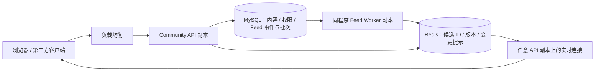

# Feed 时间线可靠性与横向扩展实施计划

状态：P0–P3 已实现；本轮按用户指示停止后续测试，部分性能门槛未通过、部分长测未执行，不等同于阶段全部完成。新分发默认影子模式，须显式启用；前端发布安排的明确调整见[验收记录](feed-validation-20261011.md#发布状态)。P4 的可选 Cluster 协议已实测，扩展收益未证明，混合分发仍按收益门槛决定。设计日期：2026-10-08；实施日期：2026-10-11（Asia/Shanghai）。设计基线：`3569ac1`；本次先拉取并冻结的新鲜对比基线：`30b84ef`。

运行参数和回退步骤见 [Feed 运行说明](../feed-runtime.md)，实际结果与尚未达到的门槛见 [验收记录](feed-validation-20261011.md)。下文保留设计目标，不把目标数字当成测量结果。

目标：在保留时间顺序、Mastodon 风格 API 和全部权限规则的前提下，用现有 Go、MySQL、Redis 获得最大的可靠性与扩展收益。本文的性能数字是验收目标，不是已经测得的结果；历史结果见 [时间线性能记录](../timeline-performance.md)。

## 1. 架构决定

**第一版保持一个程序、MySQL、Redis 三种组件。新增两张持久任务表，不新增消息中间件或微服务。**

- HTTP API 实例保持无状态，可以增加副本；账号/内容/权限和任务状态由 MySQL 管理。
- Feed Worker 使用同一个可执行文件。开发环境随 API 启动，生产可以选择 `api`、`feed-worker` 或 `all` 运行角色，独立扩容。
- MySQL 保存事务事件和批次、协调租约；Redis 保存可以重建的候选 ID 和实时变更提示。
- 第一阶段继续使用单 Redis；键与接口按 Cluster 兼容方式实现。需要时替换部署，不改业务语义。
- ActivityPub 投递、Matrix、Webhook 保持独立队列和资源预算；复用工具和运行模式，不混用受众、确认状态或重试生命周期。
- 个性化推荐、跨地域多活和读写分离不进入本计划第一版。



读路径：Redis 候选 ID → MySQL 批量加载和当前权限检查 → 批量序列化。缓存不能代替授权。实时提示不作为可靠消息存储。

## 2. 当前实现与必须保留的能力

| 当前能力 / 问题 | 实施要求 |
| --- | --- |
| `feed/home`、public/list 等监听进程内事件并启动 goroutine | 改为持久事件和有界 Worker；任务保存必须与业务写入同一事务 |
| 部分路径延迟到提交后发布事件 | 保留事务语义，但不能把提交后回调当作持久任务 |
| Redis ZSet，ID 游标，最多 512 条热候选 | 继续使用；深分页继续回源，边界仍不包含游标 |
| 缓存重建、转发聚合、批量加载、读取时授权 | 复用并补幂等和多实例并发协议；禁止为性能绕过过滤 |
| 重建协调只有进程内锁；Lua 同时访问派生键和全局 `timelines` | 增加跨实例租约；改同槽键和局部元数据，移除 Lua 内的全局索引操作 |
| 活跃粉丝按 `last_activity_at > 10天`，该字段主要由发帖更新 | 单独记录真实阅读/交互活跃；只阅读的成员必须正常获得时间线 |
| 后端有 SSE/WebSocket，网页每 45 秒查询新帖 | 网页接实时变更提示；HTTP 负责补齐和重新授权 |
| `TimelineFeed` 完整 `v-for` 渲染 | 引入可变高度虚拟列表和有界页面缓存 |
| 流序列化读取事件中的旧对象 | 输出前从数据库重新检查主帖、转发原帖、引用和通知权限 |

本计划覆盖本地帖子、收到的联邦帖子、转发、定时发布、删除与删除重发，以及关注/列表/屏蔽变化。私信和通知有独立受众，不能套用公开帖的粉丝分发。Community 不增加用户编辑帖子能力；兼容远端更新及必要的派生数据更新。

## 3. 持久分发：两张表，不按每个粉丝创建一行

### 3.1 `feed_events`：一次业务变更一行

建议字段：

- `id`、唯一 `event_key`：稳定事件身份；重试不生成新身份。
- `kind`：`status_create`、`status_delete`、`status_refresh`、`feed_invalidate`。
- `object_id`、`actor_id`、`operation_id`、`object_version`。
- `metadata`：受众类型、原帖 ID、删除所需标识、少量明确收件人 ID；不复制帖子正文、媒体或完整粉丝名单。
- `state`、`scan_complete`、`scan_cursor`、`scan_upper_bound`、`pending_at`。
- `lease_generation`、`lease_token`、`lease_expires_at`、`attempts`、`next_attempt_at`、`last_error_code`、时间戳。

`feed_events` 与帖子/关系变更在同一 MySQL 事务插入。生产环境插入失败时业务事务回滚，不允许“帖子保存成功但没有分发记录”。删除前保存清理所需 ID；不能在任务执行时依赖已被硬删除的内容。

事件只在持久任务记录中扫描 `pending` / 到期任务。**不能用全局 `id > last_processed_id` 代替任务状态：自增 ID 分配顺序不等于事务提交顺序。**

对象版本由业务事务在锁定对应内容/关系行后递增，再写入事件；迁移在需要投影的现有模型中增加 `feed_revision`，不新增版本登记表。不能拿事件自增 ID 或本机时间当版本。内容硬删除的最终版本保留在删除事件中，帖子 ID 不复用。远端更新先完成现有联邦身份和更新有效性检查，接受的变化才分配本地版本；本地版本不代表远端发送顺序。

首版只增加领取所需的 `(state, next_attempt_at, id)`、租约接管索引和对象事件查询索引；字段类型沿用仓库现有 ID 类型。`metadata`/错误码设大小上限，敏感字段不写日志。完成事件与批次按重放窗口分批清理，失败任务有独立容量预算和告警，避免队列表成为无限历史库。

### 3.2 `feed_batches`：每批受众一行

建议字段：`id`、`event_id`、`batch_no`、`target_kind`、`recipients`、租约/状态/重试字段；唯一约束 `(event_id, target_kind, batch_no)`。

批次领取索引与事件一致，并增加 `(event_id, state)` 供父任务确认。父扫描租约和子投递租约分别维护；父任务扫描完成后释放扫描槽，完成判定不能占住执行槽等待全部子批次。

初始批大小 256，允许调节到 128–1,024。十万受众约产生 391 个批次，不产生十万条确认记录。`recipients` 固定保存该批选中的账号/列表 ID 及必要版本，保证失败后重放同一批。

受众展开：

1. 作者、明确收件人和提及对象按实际可见范围处理并去重。
2. 粉丝按 `follows.id` 做 keyset 分页；第一次扫描固定上界，后续新增关系通过关系变更任务/回归重建处理。
3. 只展开当前已接受关系的本地受众；远端受众由 ActivityPub 队列处理。
4. **选出的受众批次与父事件扫描游标推进必须在同一事务提交。** 禁止先推进游标再保存批次。
5. 父事件扫描结束且所有批次完成，才可完成或进入清理状态。

关系语义：分发是候选索引预计算，采用扫描时的当前关系；不承诺冻结发帖瞬间的完整粉丝集合。读取仍按当前关系授权。新关注者获得产品定义的历史窗口；取消关注不能继续获取关注者限定内容。

候选索引的陈旧允许被读取过滤纠正；客户端已收到或已保存的历史内容无法通过服务端撤销远程抹除。

## 4. Worker 协议与资源边界

### 4.1 Claim、执行、确认

MySQL 8.4 使用短事务 `SELECT ... FOR UPDATE SKIP LOCKED` 领取事件或批次；提交租约后再访问 Redis，数据库锁不能跨 Redis 请求持有。SQLite 测试采用等价 CAS 领取，不把 SQLite 并发能力作为生产扩展证据。

- 每次领取增加 `lease_generation`，生成随机 token；初始租约 30 秒。
- 续租、扫描进度、完成、失败、取消均要求 token 和 generation 匹配、租约有效，并检查 `RowsAffected`。
- Redis/SQL 单次操作有超时，默认 5 秒；正常每 10 秒续租。
- Redis 成功后才能确认 MySQL 批次；写成功、确认前崩溃会重放。
- 使用至少一次执行和幂等投影，不承诺跨 MySQL/Redis 的 exactly-once。
- 优雅停机停止领取新任务，取消进行中的请求；未完成任务由租约接管。

仅 SQL 确认 CAS 不足以防止旧 Worker 写入 Redis。每条时间线的 Lua 写入需同时检查：

1. 批次 fencing generation：较低 generation 不能覆盖已注册的较高 generation，不能盲目 `SET` 旧 token。
2. 租约截止时间：使用 Redis 服务端时间拒绝过期令牌；fence 保存至少覆盖对应租约，不依赖进程本地时钟。
3. 对象事件版本、时间线 epoch / generation：旧 Create/Refresh 不能覆盖较新的 Delete 或失效状态。

Redis 只使用子批次的 `(batch_id, lease_generation, lease_token)` 做投递 fence；父扫描租约仅协调 SQL，不能与子租约比较 generation。注册和续期先完成 SQL CAS，再以同槽 Lua 注册有效批次租约；所有实际写入要求该租约仍匹配。用 MySQL 服务端计算租约剩余时长，扣除传输耗时和保守余量，再以 Redis `TIME` 建立截止时间，避免直接比较两台机器的绝对时钟。注册失败的批次退避，不能绕过 fence 执行。

注册与一次投递可合并成同槽 Lua：较低 generation 拒绝，相同 generation 必须 token 相同，较高 generation 才能替换。不增加“全部受众先注册完”阶段。第一版保证 SQL 租约失效后不能推进持久状态、新 generation 注册后旧写入必被拒绝；不承诺 SQL 租约到期的同一瞬间跨服务请求全部停止。接管注册前的迟到投递仍由对象版本、幂等和当前 SQL 授权保护；不能在迟到注册时重新授予完整 30 秒租约。

版本和 tombstone 的保留期必须覆盖自动重放窗口（初始 7 天），到期任务进入人工复核，不能无限自动重放。管理员对过期事件执行的是读取当前 SQL 真相的重新协调任务，不能原样复活旧 Create。Redis 清空后更换 epoch；原 epoch 的写入和快照不能发布到新缓存。

### 4.2 幂等和乱序

- 同一帖子、同一时间线的重复 Add/Remove 不改变最终结果，转发聚合集合和代表条目也必须幂等。
- Delete 后迟到 Create 不得复活；不存在/已删除内容不再写入候选集合。
- 删除重发使用两个不同帖子 ID，不搬迁旧回应。旧帖的 SQL 删除提交是全局可见性屏障；每条受影响时间线的提示先要求重新校验旧 ID，再允许展示新 ID。不能等待十万受众全部删除成功才开放新帖；Redis 候选的清理允许异步收敛，HTTP 和流始终过滤 SQL 中已删除的旧帖。
- 权限/关系变更推进时间线版本，使旧授权快照失效；服务端读取与流输出仍检查当前权限。
- 失去租约的 Worker 即使恢复运行也不得回退投影版本或推进父任务游标。

### 4.3 有界并发和公平调度

初始每个 Worker 实例 2 个受众扫描槽、4 个投递槽；每个实例最多 8 个待执行内存批次。扫描和投递使用分开的并发预算，禁止嵌套 goroutine 按粉丝无限扩张。

大账号每次扫描最多生成 4 个批次再让出执行机会。任务按到期时间调度，重试有退避；不同事件允许并行，同一对象的依赖由版本/删除屏障保证。大作者不能独占全部执行槽。

失败按指数退避加随机抖动，区分依赖不可用与永久数据错误；默认最多 12 次，超过上限进入失败状态。保留游标、事件身份和批次；后台重试不能复制任务。

队列积压、MySQL 连接等待和 Redis 延迟超过预算时降低领取速度。自动暂停和恢复需有迟滞；连接池留出 API 预算。队列磁盘预算接近上限时，写 API 在事务前返回明确 503，不能丢任务后返回成功。

## 5. Redis 候选缓存与多实例重建

### 5.1 同槽布局

使用版本化键，如：

```text
feed:v3:{home:123}:items
feed:v3:{home:123}:reblogs
feed:v3:{home:123}:meta
feed:v3:{home:123}:versions
feed:v3:{home:123}:rebuild
feed:v3:{home:123}:fence:<batch_id>
```

一段 Lua 只访问一个时间线 hash tag 下的键。批量投递跨用户可以 pipeline，并按 Redis slot/node 分组；不能做跨用户原子 Lua。大作者不会因给所有粉丝选同一个 hash tag 而形成热点。

去掉 Lua 中对全局 `timelines` 的写入。采用时间线局部元数据与到期策略；聚合派生键必须同步清理。v3 是新命名空间，旧键按既定窗口回收，不能清空全站 Redis。

保持 512 条热候选的初始上限，不把增加缓存条数作为首个优化。版本/tombstone/聚合键均需要容量与过期监测，不能只裁剪主 ZSet。

Redis 访问接口兼容 `redis.UniversalClient` 或等价封装，覆盖单机和 Cluster；检查所有具体 `*redis.Client` 假设、Lua、订阅与订阅检测。Redis Cluster 通过真实至少三主节点环境验收，不用 Mock 代替。

### 5.2 重建协议

`ZSET 存在`不代表缓存完整。meta 至少记录 `epoch`、`generation`、`ready`、覆盖范围和最近校验时间。

meta 缺失时，普通 Worker 拒绝写入并请求重建，不能用旧任务的 epoch 初始化缓存。只有重建协议可以通过同槽 Lua 创建随机新 epoch、登记租约并标记不完整；清空/重建后的旧 token 一律不匹配。新一轮批次领取重新读取 epoch，并以当前 SQL 内容/版本生成操作；旧尝试不能换上新 epoch 继续写旧快照。正确性元数据须完整校验，Redis 首版使用 `noeviction` 并监测容量，缺键/写失败进入重建或回源，不能把被淘汰的版本/fence 当作零版本接受旧写入。

1. 缓存缺失/不完整时，尝试领取同槽重建租约；其他 API 实例短暂等待或进入有界数据库回源。
2. 领取时捕获 epoch、generation 和 fencing token，查询当前 SQL 候选。
3. 普通分发、关系/权限失效都原子推进相关 generation。
4. 仅 epoch、generation、重建租约仍匹配，才原子发布快照并设 `ready=true`。
5. 校验失败丢弃快照，不覆盖当前缓存；最多立即重试 2 次，持续写入时回源，稍后重建。

不能仅按最大 status ID 合并快照：低 ID 事务延迟提交、删除、关系变化都可能越过这个假设。进程内 singleflight 可保留，作为减少本机重复工作的优化，不能承担跨实例正确性。

读取检查完整性与当前权限；不完整索引走 SQL 回源。已 ready 的索引采用有界最终一致，队列收敛后必须与 SQL 完整一致；异步分发不承诺 SQL 提交瞬间所有受众缓存已更新。权限与删除过滤始终使用当前 SQL，不等待队列收敛。被过滤候选继续补页，游标必须推进且受请求时限约束。

### 5.3 Redis 故障

Redis 超时/不可用：持久投递保留并退避；HTTP 走有界 SQL 读取或明确 503。不能把 Redis 错误当空时间线。

SQL 回源设置进程内并发限制、超时和页大小，避免 Redis 故障引发 MySQL 雪崩。恢复后只按活跃需求逐步重建，不全量扫描所有账号。

Cluster 是第二阶段的部署选项。单机 Redis 未成为瓶颈前不强制引入；数据正确性和故障恢复不依赖 Cluster。

## 6. 活跃、回归与权限变更

- 单独记录成功认证的 Feed 阅读、有效交互及有活跃客户端的流心跳，初始用 Redis 节流，同账号最多每 5 分钟更新持久 `feed_last_seen_at`。
- 新注册/首次阅读、只阅读不发帖的账号都有明确路径，不能用 `last_status_at` 代替阅读活跃。
- 活跃窗口先保留 10 天作为可调参数；无订阅不等于无需可靠保存任务。
- 长期离线、缓存不完整、关注/列表成员变化或 ACL 版本变化后，重新构建当前历史窗口，再开始增量消费。
- 关注批准、取消关注、屏蔽/静音、域封禁、封禁账号、列表成员变更必须覆盖事务失效事件。
- 私信只发给作者和明确收件人。流发送前重新加载并授权，转发/引用/通知也各自检查；不能把事件中旧正文直接输出。

## 7. 网页实时更新与虚拟列表

### 7.1 实时提示，不新增可靠流存储

网页首先使用现有、认证方式兼容的 SSE 或 WebSocket。复用现有协议；新网页可使用 `feed.changed` 提示，内容仅包含对应用户时间线的 epoch / revision，不包含正文或私密帖子 ID。第三方客户端已有事件继续支持，但输出前必须重新授权。

- API 副本经 Redis 接收提示，同实例订阅复用并设置缓冲/慢客户端上限。
- 客户端 250ms 合并一波变化提示，发一个当前授权 HTTP 请求；不按每个事件请求整页。
- 首次连接、重连、epoch 变化、权限变化或窗口覆盖不足时重新校验当前窗口，不能仅用 `since_id` 恢复删除/撤销。
- 断线期间积累超过热窗口时明确 reset，重新建立窗口和滚动锚点；不承诺无限期事件逐条重放。
- 保留低频轮询兜底，连接正常时停用高频轮询，页面隐藏时暂停拉取；重连指数退避带抖动。
- 新内容先累积提示，用户点击后展开，避免正在阅读的位置跳动。
- 账号切换清空连接、任务、页面缓存和迟到响应；旧账号私信不能恢复到新账号页面。
- 收到撤销/失效提示后剔除失效卡片或重新校验；网络恢复时先丢弃未验证旧窗口再取数据。

### 7.2 可变高度虚拟列表

复用 `TimelineFeed` 接口，替换内部完整渲染。优先选择现有依赖或一个小型、维护中的虚拟列表库，不实现通用框架。

- stable key 使用外层 status ID；转发聚合仍保持当前规则。
- `ResizeObserver` 测量图片加载、内容警告展开、投票和回应选择器导致的高度变化，保持滚动锚点。
- 视口加 overscan 正常不超过 60 张挂载卡片；正在编辑/聚焦/打开菜单的最多额外保留 8 张。
- 网络分页缓存初始最多 8 页；较远页面按 LRU 释放内容，保留必要的 ID 游标/高度元数据，回滚时重新加载。
- 高度元数据也需上限，长距离回滚可以重新建立窗口，不能以无限内存换取“永远精确恢复”。
- 导航返回保持位置、键盘焦点、屏幕阅读器可操作性；不因虚拟化把表单输入丢失或把焦点移到其他帖子。
- 图片离开窗口暂停/取消不必要工作；避免每张卡片创建独立长连接或轮询。

## 8. 混合分发：达到收益门槛再启用

前述可靠写时分发是第一版。只有大作者成本占比显著、且读时合并在相同权限负载下有收益，才引入普通作者 push / 大作者 pull。

初始观察阈值：最近活跃的本地粉丝超过 10,000，或该作者投递占总 Redis 写入量超过 20%；这是触发评估，不是直接自动切换。远端粉丝数不能作为本站 Feed 放大倍数。

实现要求：

- 作者 `feed_mode` 和策略版本持久化；模式切换期间双路径读取并去重，不能直接切断投递制造缺口。
- 读取将 push 候选与当前关注的 pull 作者内容按同一 ID 顺序合并，复用补页、权限和转发聚合。
- pull 作者用批量 SQL/共享作者缓存获取，不能每个作者一次查询；不设会静默漏帖的作者数量上限。
- 仍支持 `max_id` / `since_id` 等现有参数。实时断线后的补齐不能假设新提交内容 ID 一定大于上次顶部 ID。
- 页面候选不足继续读取来源，不以不足一页伪造“没有更多”。
- 活跃作者名单、缓存失效、模式回切都需要一致性验收。

启用门槛：大作者场景 Redis 写放大降低至少 80%，整体内存/SQL成本可控，首页 p95 不超过相同场景 push 模式的 110%；否则维持写时分发。

## 9. 实施顺序与代码落点

| 阶段 | 实现内容 | 主要落点 | 出口条件 |
| --- | --- | --- | --- |
| P0：基线与契约 | 固定权限/排序/回归语义，建立读、写分发、故障和多实例基线 | `scripts/benchmark-timelines.py`、新增写入/故障压测脚本、Feed tests | 真 SQL oracle 与样本一致；保存原始结果和冻结二进制 |
| P1：可靠分发 | 两张表、事务接入、受众批次、租约、幂等、fencing、版本；v3 同槽键 | `models/feed_*`、`migrate/scripts`、`feed/worker`、`feed/home/public/list/tag/mention/notification`、`cmd/community` | 事务/崩溃/重放/乱序等本阶段可靠性断言全过；先开启一个 Worker |
| P2：多实例读取 | 多实例重建、完整性标记、阅读活跃、权限失效、Redis 故障回源、流发送授权 | `feed/rebuild.go`、`feed/invalidate.go`、`feed/get_timeline_content.go`、`controllers/api/streaming` | 两 API / 两 Worker、重建竞争和 Redis 故障验收通过 |
| P3：用户端性能 | 实时提示/重连重校验、可变高度虚拟列表、有界缓存 | timeline store、`HomePage.vue`、`TimelineFeed.vue`、共享流 composable | 浏览器正确性和 DOM/延迟指标通过 |
| P4：按需扩展 | 真实 Cluster、混合分发；仅在已测得瓶颈时上线 | Redis client、作者模式、候选合并 | Cluster 无跨槽错误；混合策略达到收益门槛 |

P1 的事件覆盖必须列出全部创建入口：网页/API、联邦 inbox、转发、定时发布、管理员处置、导入后的重建边界。不能只改一个 Controller。导入仍使用维护边界/批量失效，禁止给历史数据重新发送通知和联邦内容。

每一阶段独立提交，阶段出口未通过不切默认路径。先建立观测再改算法，不同时更改数据集、权限与数据库参数计算性能提升。

## 10. 验收：正确性优先，性能有明确测量口径

### 10.1 必须全部通过的正确性与故障矩阵

| 场景 | 验收断言 |
| --- | --- |
| 帖子事务回滚；任务插入失败 | 没有已提交帖子/投递；不能提前出现客户端正文或通知 |
| 提交后进程立即退出 | 重启/其他 Worker 接管后完成，所有应投递受众可读 |
| 批次生成前后崩溃 | 游标不越过未持久批次，不漏受众 |
| Redis 成功、DB ack 前退出 | 重放不重复、不改变聚合结果，父任务最终完成 |
| 两个/八个 Worker 竞争；租约过期 | 只有有效租约推进状态；旧 Worker 恢复后 Redis 不回退版本 |
| 一个批次 Redis 失败；后续其他作者持续发布 | 失败批次可恢复，其他作者不饿死，不无限增加 goroutine |
| Delete 后迟到 Create；远端更新乱序 | 删除不可复活，旧版本不能覆盖新版本 |
| 删除重发 | 旧 ID 删除、新 ID 创建顺序符合规则，旧回应不迁移 |
| 屏蔽、取消关注、域封禁、私信/通知权限撤销与投递竞争 | HTTP 和流均不输出当前不可见正文、原帖、引用或身份 |
| 两 API 同时冷重建；查询期间有写入/失效 | 只有有效快照发布，低 ID 延迟提交不因 cutoff 丢失 |
| Redis 停止 60 秒、恢复/清空 | 不返回假空页、不丢持久任务；回源有界；新 epoch 拒绝旧写入 |
| Redis 清空后暂停的旧 Worker 恢复；新 Worker 已接管 | 旧 Worker 不能创建 meta/旧 epoch；新 generation 注册后，旧注册、续期和写入全部拒绝 |
| MySQL 不可用 | 明确失败；不返回业务写入成功，不让内存任务无限增长 |
| 流断线期间新增、删除、撤销 | 重连重校验后与 HTTP 授权结果一致，不能只新增不删旧卡片 |
| 只阅读、不发帖；离线超过活跃窗口后回归 | 正常获得当前授权时间线；不依赖发帖激活 |
| 账号/标签/列表切换 | 没有旧目标或旧账号的迟到响应、滚动/缓存污染 |
| 真实 Redis Cluster 故障接管 | 无 CROSSSLOT；聚合、删除、重建和失效正确 |

固定数据上遍历至少 10,000 条结果，与独立 SQL oracle 比较：ID、顺序、受众、原帖、媒体、投票、表情及分页一致，零重复、零漏帖、零越权。持续写入场景另测：不重复、不越权，队列清空并重新校验窗口后与 SQL 收敛；不把 ID 游标误称为跨事务快照分页。

### 10.2 基准负载

保留现有 2,000 账号 / 60,000 帖子的读基线，再建立两种独立实验数据集：

- 中型：10,000 本地账号、1,000,000 帖子、1,000,000 已接受关系；包含读取型用户、500/5,000 关注数、稀疏/密集标签、媒体和所有可见范围。
- 写放大：分别构建 1,000 / 10,000 / 100,000 个本地受众的作者，明确区分“总粉丝”“活跃受众”“远端粉丝”；无法承载的大档标为未验收，不外推。

读写混合先以 90% 读取 / 10% 写入启动，逐步增加到瓶颈。每次记录真实受众数、候选/输出条数、API 全响应延迟、分发完成延迟、队列年龄、错误率、SQL行数/连接等待、Redis操作/内存、CPU、GC、goroutine及浏览器资源。

暖读、Redis 冷缓存并发、深分页、恢复期间、大作者发布分别测。使用有界开放到达率压测，记录实际发送时刻和超时，避免闭环客户端隐藏排队。每档预热 2 分钟、测量至少 10 分钟、重复 3 次；稳定档增加 60 分钟混合负载和恢复测试。

### 10.3 初始通过门槛（在 P0 确认硬件后锁定）

| 指标 | 通过门槛 |
| --- | --- |
| 权限/分页/故障正确性 | 全部通过，零数据泄漏、零永久丢任务 |
| P1/P2 相同读负载回归 | p95 不劣于新鲜基线 110%，有效吞吐不低于 90%；不能以漏帖换速度 |
| 正常发布到应投递的活跃本地受众 | 中型稳定档 p95 ≤ 1 秒、p99 ≤ 3 秒；记录完整分发而非第一个粉丝 |
| 10,000 受众的大作者 | 分发 p95 ≤ 5 秒；普通作者分发 p95 不超过无大作者档的 120% |
| Worker 扩展 1 → 2 → 4 | 共享依赖未饱和档，吞吐分别目标 ≥ 1.6× / ≥ 2.8×；记录增加的 CPU，不把单机多进程当无限扩展 |
| API 扩展 1 → 2 | 固定每实例 CPU、共享数据库/Redis预算，在未饱和档有效吞吐目标 ≥ 1.5×，p95 不恶化超过 10% |
| 故障积压恢复 | 恢复后排空能力至少为正常产生率 2×，全部收敛；恢复期间正常请求遵守已有预算 |
| 网页连接正常 | 从 Worker 发布提示到网页显示新内容提示 p95 ≤ 1 秒；发布到分发完成另计，不强制跳到顶部 |
| 2,000 / 5,000 条滚动 | 通常挂载 ≤ 60 张卡片，临时保留最多 +8；页面缓存 ≤ 8 页，无无限 DOM/内容增长 |
| 可变高度与导航返回 | 锚点漂移 ≤ 8px；展开内容警告、媒体加载、回应和回复输入不丢焦点/草稿 |
| 滚动长任务 | 在固定桌面及移动 CPU 限速档，>50ms JS 长任务次数较完整渲染基线减少 ≥ 80%，保留 trace |
| 混合分发 | 大作者 Redis 写入降低 ≥ 80%，相同权限工作量首页 p95 ≤ push 档 110% |

达不到门槛需给执行计划/资源瓶颈与重新测量结果，不能静默放宽。DB/Redis 已饱和时停止声称线性扩展，说明下一步增加哪种资源的收益和成本。报告输出 commit、二进制 SHA、拓扑、全部配额、原始样本和有效返回签名。

## 11. 观测、切换和回滚

必要指标：任务最老年龄、pending/failed数量、受众扫描/投递速率、重试/租约接管/fence拒绝、缓存命中/不完整/重建失败、SQL回源、Redis耗时、ACL过滤、流重连/合并提示、HTTP p95/p99。指标不以用户 ID / 帖子 ID 为 label，不记录私信正文或令牌。

最小管理入口复用现有作业队列：按任务状态查看、安全重试和取消；失败原因用固定错误码。取消影响派生缓存任务，不删除业务帖子；不应绕过父事件依赖和授权。

切换：

1. 先部署新增表和 Worker 代码但不开分发；确认所有事务入口写入事件。
2. 使用独立 v3 命名空间影子生成候选，只比较授权结果，不重复通知/客户端事件。
3. 单 Worker + 小范围账号读取 v3，验证后扩大；同一事件只有一个生效分发/提示路径。
4. 旧进程事件投递只在明确的回退开关下保留，默认切换后移除嵌套 goroutine。
5. API 和 Worker 分开扩容，再按测量决定 Cluster / hybrid。

回滚：停 v3 领取和提示，保留持久事件/批次历史；旧路径恢复后按当前 SQL 重建。队列不能清空，旧客户端卡片不能当作授权依据。模式/epoch/旧缓存兼容必须有演练，回滚不自动删除新表。

## 12. 完成定义

每个阶段必须交付：代码及迁移、确定性的权限/故障测试、真实 MySQL/Redis 多实例结果、必要浏览器结果、配置说明、原始压测报告和回滚记录。Mock 通过、单次冷读、空页变快、历史二进制结果都不能替代当前实现的验收。

推荐先实现 **P0–P2**，解决可靠性与多实例正确性；**P3** 提供最直接的网页性能收益。**P4** 由已证实的 Redis / 大作者瓶颈驱动，不提前扩大部署复杂度。
